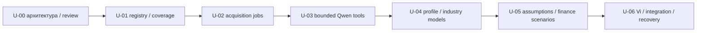

# Business AI 2.0 — план после U-00

28.10.2026. Владелец выбрал **ровно семь этапов U-00…U-06**. Этот документ
декомпозирует их, не разрешает начинать U-01 и не объявляет реализацию выполненной.
Архитектура: [основной документ](BUSINESS_AI_2_UNIVERSAL_ARCHITECTURE.md),
[data/tools contracts](BUSINESS_AI_2_DATA_AND_TOOLS.md), [ADR-0013](../adr/ADR-0013-universal-analysis.md).

## 1. Конфликт ID и старого roadmap

[POST_MVP_ROADMAP v1](../roadmap/POST_MVP_ROADMAP.md) ввёл U-00…U-12 в planning
commit `d0900b0`; позже `dac226a` уточнил readiness, `e17389b` baseline,
`3bb17e0` приоритет hackathon frontend. Содержание старых карточек не соответствует
новым коротким ID: старый U-01 — отрасли, новый U-01 — источники.

Используем явные ссылки **BA2/U-xx** для инициативы владельца и **roadmap-v1/U-xx**
для старых карточек. Это namespace ссылок, не переименование утверждённых этапов.
Ветка текущего PR остаётся `codex/U-00-universal-analysis-architecture`.
В названиях будущих PR писать `Business AI 2.0 — U-01: ...`, не голое «U-01».

| Старая карточка (без смены её статуса) | Соответствие новому плану / граница |
| --- | --- |
| roadmap-v1/U-00 ADR/совместимость | BA2/U-00; расширено planner/source/tool/job/sufficiency проектированием |
| roadmap-v1/U-01 отраслевой реестр | BA2/U-01 только capability skeleton; BA2/U-04 полные отраслевые модели |
| roadmap-v1/U-02 canonical profile refs | BA2/U-01 read-only bridge; BA2/U-04 versioned profile API/migration |
| roadmap-v1/U-03 города/ambiguity | BA2/U-01 canonical territory refs; BA2/U-04 dialogue/profile normalization |
| roadmap-v1/U-04 budget/currency/corrections | BA2/U-04 extraction/confirmation tests; RUB-only до явного отдельного расширения |
| roadmap-v1/U-05 отраслевые геополитики | BA2/U-04 methods/capabilities + BA2/U-06 интеграция |
| roadmap-v1/U-06 finance v2 inputs | BA2/U-04 schemas/driver definitions, BA2/U-05 adapters/scenarios |
| roadmap-v1/U-07 четыре finance templates | BA2/U-04/05, набор отраслей не объявляется автоматически прежними4 или полностью готовым |
| roadmap-v1/U-08 territory/pipeline | BA2/U-01 registry + BA2/U-02 bounded jobs/import |
| roadmap-v1/U-09 вторая территория Самары | BA2/U-02/06 bounded qualification; Москва из нового задания — кандидат, не уже поддержанный город; старый критерий Самары не закрыт |
| roadmap-v1/U-10 AnalysisRun/workspace | BA2/U-02 foundation jobs/run ownership; BA2/U-04/05 input/results; BA2/U-06 resume |
| roadmap-v1/U-11 drafts/reload | BA2/U-06 после persist contracts предыдущих этапов |
| roadmap-v1/U-12 bank/consent/report compatibility | обязательная регрессия каждого этапа и BA2/U-06 versioned report при необходимости |

Старые условия Architecture Stabilized/Beta/RC, четыре отрасли/две территории,
UX/исследовательские gates не считаются выполненными этим сопоставлением.
Владелец явно разрешил текущую архитектурную работу новой инициативы; BA-017/018
остаются отдельно, а их старые зависимости не переписываются как «закрыто».
Security baseline OPEN — ограничение внешнего выпуска, не заявление о блокировке docs.

## 2. Порядок внедрения

Один этап может требовать нескольких **небольших последовательных PR одного этапа**.
Суффиксы `.a/.b` — только внутренняя декомпозиция, не новые крупные этапы и не разрешение
обойти владельца. Перед кодированием пересчитать scope; более6–10focused часов либо
две независимые миграции — предложить разделение. Не считать весь BA2/U-02/06 маленьким
8часовым PR заранее: job recovery/egress/новая геометрия требуют измерений.

## U-01 — Реестр источников и данных

**Зависимость:** review/принятие U-00 и отдельное разрешение начать.

- U-01.a: валидируемый SourceDefinition/capability metadata/territory refs, effective
  config hashes; реестр только действительно реализованных OSM/Synthetic adapters.
  GHSL/официальная статистика/licensed остаются not_integrated до evidence.
- U-01.b: DatasetRevision/CoverageAssessment поверх существующих datasets/providers;
  observed dates, license review, per-layer AOI/time, freshness/completeness, nullable gaps.
  При необходимости additive metadata migration с populated fixtures. Не копировать POI.
- LegacyProfileAdapter даёт read-only профиль v2 из5полей; новые поля unknown. Это не
  новый extractor и не обязательный PATCH v2 до U-04. Минимальный IndustryDefinition
  описывает5существующих geo groups/только реальные capabilities, без новых отраслевых формул.

**Контракты:** server registry snapshot, CoverageQuery→Assessment, typed source refs;
без внешнего fetch. Public metadata — безопасная projection без private endpoint policy.
**Тесты:** duplicate/unknown IDs, schema/config hash mismatch, current/stale/partial,
outside AOI, source offline+usable cache, unknown completeness, units/period/license,
negative cache expiry, old IndicatorResult/finance/report goldens.
**Приёмка:** Kazan metadata воспроизводима, Moscow coverage честно missing/unknown,
а не auto Kazan;7coverage случаев различимы, отсутствие OSM объекта не «нет бизнеса».
**Локально:** маленькие synthetic registry/dataset fixtures + изолированный PostGIS;
GET current datasets/provider API неизменён. Риск: license/policy нельзя вывести из200OK.

## U-02 — Автоматическая загрузка

**Зависимость:** U-01 registry/coverage/policies, H-04 migration/backup invariants.

- U-02.a: expand AnalysisRun ownership/version envelope и durable job/task/event/resource
  lease schema; safe cancel/recovery/idempotency. Не отдавать ownerless старые rows гостям.
  Старт с v1-compatible profile snapshot; no-map empty dataset refs только в versioned v2.
- U-02.b: operator worker из того же codebase, bounded fetch/validate/staging/checkpoint,
  protected activation существующих datasets; host-wide heavy admission и fail-closed
  stale leases. Отдельный broker не добавляется.
- U-02.c: small-tile OSM acquisition/normalization/index/dedup/quality и restart rehearsal.
  Прежде чем расширить current in-memory parser, измерить RSS; больших городов в RAM нет.
  Источник не public Nominatim POI lookup; разрешённый snapshot/export по reviewed policy.

**Контракты:**202job intent/status, shared-dataset subscriptions с private owner view,
checkpoints+SHA, expected active version, fencing; public user triggering включается
только через validated orchestrator после U-03/06. Нет raw URL endpoint.
**Тесты:** две competing claims, duplicate key/new guest, corrupt/truncated artifact,
compression/depth/bytes/time/RAM/disk caps, missing DB, revoke/cancel/network loss,
restart after batch/до activation/после commit; old worker heartbeat lost не освобождает
host slot без остановки. Counts/FK/geometry/indexes/OSM IDs/graph seams, старые hash неизменны.
**Приёмка:**1active/ограниченная очередь доказаны; invalid datasets не active; rerun
не дублирует; предыдущая версия доступна; peak RSS и общий memory budget записаны.
**Локально:** fixture fetch server (никаких public load tests), один малый разрешённый
AOI после operator review и isolated DB. Риск: cancellation/fencing≠убийство процесса;
накладные расходы JSON/graph/WAL могут превысить размер файла в разы.

## U-03 — Qwen Tool Agent

**Зависимость:** U-01 capabilities + U-02 safe acquisition/job status.

- U-03.a: отдельный `PlanProposal` schema/prompt/validator; existing extraction prompt384
  не заменять огромным universal prompt. Начальный corpus coffee/unknown/online goals,
  пока новые sector models ещё unavailable.
- U-03.b: whitelist ToolRequest→Result, permission/context injection сервером,
  runtime budgets, dedup calls, deterministic DAG expansion/sufficiency checks.
  Internet broker только для approved adapters; generic search остаётся disabled,
  если нет проверенного бесплатного/разрешённого источника.
- U-03.c: SSRF/redirect/DNS-rebinding/peer-IP enforcement и prompt-injection tests,
  отдельно real Qwen4B plan-quality/time/RAM evaluation. Наличие JSON не означает
  корректность выбора метода. Backend может безопасно отклонить все предложения.

**Контракты:** immutable snapshot→proposal→validated AnalysisPlan;2proposals/8tool calls
кандидат, counters persisted, queue H-03 одна. No SQL/shell/files/user URL tools.
**Тесты:** invented tools/revisions, cycles, duplicate requests, mandatory dependency
removal, source instructions, private/mixed/IPv6 DNS/redirects, oversized response,
revoked consent/profile edits while waiting, PG connection released, timeout slot recovery.
**Приёмка:** любой неправильный plan fail-closed до side effects; partial/clarification
вместо бесконечного repair; live качество и задержки по сценариям с n/N, не только stub.
**Локально:** deterministic mocked transport и tiny HTTP fixtures; opt-in local Qwen
serial, без параллельного импорта. Риск:768output tokens/6tasks может быть недостаточно;
настройки меняются только по evidence, без расширения аппаратных требований.

## U-04 — Универсальные отраслевые модели

**Зависимость:** U-03 validated planner, existing industry/config skeleton U-01.

- U-04.a: strict ProfileV2/typed patches/owner API, field evidence/review, additive storage
  extension/canonical refs без изменения v1; unknown industry retains raw label/null ID.
  Адаптивные вопросы, ambiguity/city/budget corrections, confirmation invalidation.
- U-04.b: versioned sector definitions, applicability, geo policy refs, driver/cost/capacity
  schemas. Coffee legacy parity; auto repair posts/duration/vehicle context и online-school
  subscription/audience/marketing units. Специальный метод unavailable, пока нет executor.
- U-04.c: reviewed method registrations + deterministic rules/goldens. Не переименовывать
  walking в vehicle routing; полная автомобильная маршрутизация требует отдельного scope
  решения, если bounded context indicators недостаточны. Отсутствующий метод остаётся gap.

**Контракты:**ProfileV2/IndustryDefinition/CityRef, server-generated applicability,
separate v1/v2 routes; профиль не требует карту для online. Финансовые definitions
не означают готовый финансовый результат до U-05.
**Тесты:**4сценария, unknown/no-map, legacy5geo groups goldens, same-name cities,
foreign currency not RUB, holdout corrections, CAS/consent races, config revision switch,
populated migration/old report bytes. Changed extraction требует QG-LLM live regression.
**Приёмка:** новый сектор не выбирает nearest coffee; online не застревает на geo;
набор вопросов следует missing requirements; support явно per-module.
**Локально:** fixtures + independent geo/finance oracle; реальный bounded город только
если U-02 qualified. Риск: arbitrary weights/aliases и ложная поддержка всей Москвы.

## U-05 — Генерация допущений и сценарии

**Зависимость:** U-04 profile/driver schemas + sufficiency U-01/03.

- U-05.a: AssumptionProposal/review/revisions/ranges/units; Qwen даёт гипотезу,
  backend валидирует, пользователь подтверждает/меняет; без подтверждения critical
  assumed input не проходит в расчёт.
- U-05.b: reviewed Python financial adapters и v2 line items где v1 неэквивалентен,
  capacity/period/revenue/cost validation,3сценария и sensitivity. v1 engine untouched;
  coffee adapter обязан давать прежний результат. Никакого eval из sector config.
- U-05.c: dependency/assumption lineage в stored runs/results и partial reporting.
  Нет скрытых defaults; calculated_from_assumed не выдаётся за измеренную статистику.

**Контракты:** ParameterSet/AssumptionDecision/FinanceAdapterDefinition,
FinancialMetric v2 reference envelope, v1 output unchanged. Monte Carlo extension
point предусмотрен, реализация в этот этап не включена без отдельного решения.
**Тесты:** unknown≠0, rejection/refinement, negative results, Decimal/Fraction oracle,
exact legacy hashes, capacity≤throughput, churn periods, duplicate cost IDs, v1/v2 unit
mapping, rent monotonicity, changed assumption invalidates report, concurrent review.
**Приёмка:** три сценария воспроизводимы из immutable inputs, каждое число имеет
lineage; ни auto service, ни online school не используют coffee assumptions автоматически.
**Локально:** pure Python tests без LLM для arithmetic; маленький opt-in Qwen proposal
smoke отдельно от формул. Риск: диапазон от модели не является confidence interval.

## U-06 — Интеграция Ви и сквозные испытания

**Зависимость:** U-01…05 и разрешение владельца.

- U-06.a: minimal frontend adapter для conditional stages/no-map, durable run/draft
  restore, events polling/cursor/revision, safe retry/cancel/late response guards.
  Server state первичен; local stage counter не даёт права перейти дальше.
- U-06.b: существующие ViEmotion/Motion mapping, при отдельной подготовке — поиск
  с подзорной трубой. Busy только actual task; unknown total без процентов.
- U-06.c: downstream bank/consent/lead compatibility; при необходимости отдельный
  report-v2 serializer для новых результатов, historical v1 bytes не переписываются.
  Reports должны сохранять unavailable/partial/assumed sections, не только успехи.

**Тесты:** A legacy end-to-end; B auto repair/bounded Moscow AOI с honest missing car
capability; C online school без карты; D unknown partial; reload/back/network loss/
guest expired/profile edit/revoke/stale dataset/worker restart; owner/CAS/idempotency;
PDF/JSON agreement/old snapshots, desktop/tablet/mobile/keyboard/reduced motion.
**Приёмка:** реальные backend tasks/progress/results, без prepared market numbers;
отсутствующая data/method оставляет partial, не успешный fabricated result. Для B
нельзя считать демонстрацией нового города один map tile — нужен qualified imported AOI.
**Локально:** isolated fixtures/DB mock E2E + отдельный serial real Qwen/small-AOI
rehearsal; записать warm/cold latency, RSS/DB connections, cancellation/restore,
real screenshots. Риск: длинный процесс и UI progress не равны ready report.

## 3. Проверяемые stop/go решения на локальной машине

| Перед включением | Нужное evidence / действие при отказе |
| --- | --- |
| Public acquisition | source/terms/endpoint approval + SSRF peer enforcement + quota tests; иначе operator-only/disabled |
| New city | AOI boundary/version/слои/quality/RSS/disk; иначе smaller tile/partial, не whole-city import |
| Qwen planning | budgeted real4B evaluation, old extraction regressions; иначе deterministic fallback questions, без silent stub facts |
| Parallel import/inference | measured combined peak на16GB/реальном Docker allocation; до этого host heavy slot запрещает overlap |
| Persistent v2 | populated migration/backup/owner isolation/nullable legacy CHECK/goldens; иначе v2 admission off |
| New sector finance | typed units/capacity/oracle/lineage; иначе unavailable, не coffee output |
| Release | отдельно закрытая security baseline и согласование владельца;10green CI не заменяют этот gate |

Не обещаем гарантированные RPO/RTO или поддержку всей Москвы за счёт архитектуры.
Нет новых платных API, Redis, Celery, GPU model или обязательного аппаратного upgrade.
После U-00 владелец сначала проверяет ADR/crosswalk/предлагаемые resource caps и
выбирает первый ограниченный scope U-01; без этого U-01 не начинается.
