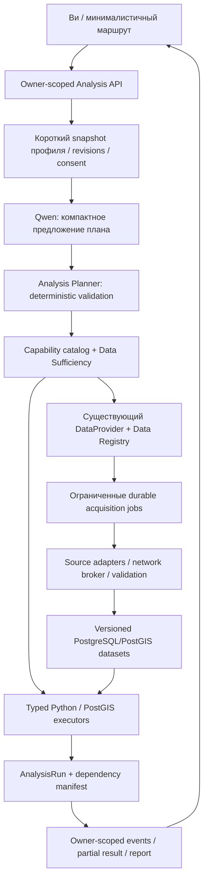

# Business AI 2.0 — U-00: универсальная архитектура

Дата: 28.10.2026. Проверенная база: main `0c7749b05f17aad9ad16e4350d267a28ef45e119`,
PR30 merged. **Архитектурный проект для review владельцем**, не реализованная система.
В U-00 нет миграций, новых endpoints, загрузок или изменений алгоритмов/LLM/UI.
Решения: [ADR-0013](../adr/ADR-0013-universal-analysis.md).
Детальные [контракты данных и инструментов](BUSINESS_AI_2_DATA_AND_TOOLS.md),
[план и сопоставление roadmap](BUSINESS_AI_2_IMPLEMENTATION_PLAN.md).

**Уточнение29.10.2026:** U-00/ADR приняты владельцем после PR31. Частичная реализация
новой архитектуры — [registry/coverage U-01](BUSINESS_AI_2_DATA_REGISTRY_IMPLEMENTATION.md);
исторический аудит/проект ниже не означает, что остальные модули уже реализованы.

## 1. Проверенное исходное состояние

| Область | Код и реальное поведение | Переиспользовать / расширить |
| --- | --- | --- |
| Монолит | [main.py](../../apps/api/app/main.py), typed REST, SQLAlchemy/psycopg, 8 Alembic revisions до0008 | Один backend, одна PostgreSQL/PostGIS, отдельные модули Python; не микросервисы |
| Диалог | [Conversations](../../apps/api/app/services/conversations.py), owner token hash, profile revisions/messages, optimistic version, review/consent | Сохранить владение, CAS, сброс подтверждения при смысловой правке |
| Qwen | [adapter](../../apps/api/app/adapters/llm.py): `/api/chat`, JSON Schema в `format`, единственный `extract_business_profile`; это structured extraction, не автономный tool agent | `DialogueLLM`, валидаторы, transport/errors; новый planner отдельной capability |
| Контекст | В БД полная история; immutable MessageInput содержит профиль и4последних сообщения; модель получает5полей профиля, последний вопрос≤500символов и текущий ввод | Не отправлять всю историю/реестр/геоданные в4K context |
| LLM safety | evidence — цитата текущего ввода, whitelist5полей, Pydantic, ambiguity; пользовательский ответ в основном серверный `reply_for` | Формат/цитата не доказывают смысловую правильность; неизвестную отрасль нельзя заменять кофе |
| H-03 | [dialogue.py](../../apps/api/app/services/dialogue.py): read snapshot → закрытие session → очередь/inference → новая session/owner/CAS/consent → atomic write | Ни DB transaction, ни row lock на время LLM/сети/ожидания jobs |
| Геоданные | [geo_datasets/geo_pois/geo_districts](../../apps/api/app/db/models.py), versioned manifests/SHA, 4326 geometry, spatial indexes; walk_graphs/walk_edges отдельно | dataset slug/version и per-layer coverage, не новые копии OSM |
| Импорт | [geo.cli](../../apps/api/app/geo/cli.py), [walk_cli](../../apps/api/app/geo/walk_cli.py): operator fetch/import, hash/atomic activation/advisory locks; POI batches500 | Fetch уже существует. Нет durable download jobs, canonical cities или agent-safe network broker |
| Георейтинг | [candidate_policy](../../apps/api/app/geo/candidate_policy.py): coffee/bakery/restaurant/salon/grocery, aliases; [scoring](../../apps/api/app/geo/scoring.py): transit/infrastructure/complementary/competitors, cohort min-max | Версионируемые policy configs, старый score сохранить; это OSM proxies, не спрос/прибыль |
| Сеть | walking topology/access/barriers/Dijkstra; запрос ограничивает20Kedges/5KPOI | Не автомобильная маршрутизация; car-access capability пока unavailable |
| Источники | [DataProvider](../../apps/api/app/data/providers.py), OSM/Synthetic; GHSL/Licensed not_integrated; `ProviderDataset`/nullable `Indicator`/fingerprints | Расширять существующие metadata/provider contracts; не второй provenance store |
| Финансы | [engine](../../apps/api/app/finance/engine.py): Decimal64/HALF_UP,3сценария/BE/one-at-a-time sensitivity; `selected_zone` optional | Формулы уже отделены от георейтинга; жёсткие cost buckets/unit sale и один frontend coffee template требуют adapters |
| AnalysisRun | DTO и [ORM](../../apps/api/app/db/models.py) существуют; live services не создают rows, нет owner FK, `dataset_versions` обязан быть непустым | Нельзя считать это работающим workspace; расширение с версиями/ownership, не замена отчётов |
| Отчёты | [reporting](../../apps/api/app/reporting/service.py): server recompute/fingerprint verification, owner-scoped immutable JSON/PDF/SHA/stale reasons | Старые bytes/schema/hash неизменны; отдельный serializer v2 при необходимости |
| UI/Ви | [flow.ts](../../apps/web/src/flow.ts), [BusinessFlow](../../apps/web/src/BusinessFlow.tsx), [Vi](../../apps/web/src/Vi.tsx): последовательные stages, busy/error/result | Нет backend progress events/durable jobs. Карта сейчас обязательна frontend guard, хотя finance API её не требует |
| Reload | Guest credential в sessionStorage; профиль/история в БД; выбранная зона/finance/bank draft в памяти React | Домой сохраняет mounted проект; reload не восстанавливает весь анализ, потерянный guest token не восстанавливается |

Lock на этой базе: Python3.12.x (`>=3.12,<3.13`), FastAPI0.146.0, SQLAlchemy2.1.5,
Alembic1.20.0, Pydantic2.14.1, psycopg3.3.6, httpx2 2.14.0, reportlab4.5.1,
uvicorn0.54.0; React19.3.1, TS5.9.3, Vite7.3.7, MapLibre6.15.0. Это версии lock,
не автоматическое доказательство состава каждого запущенного контейнера.
Repository hardened target: PG17.11/PostGIS3.6.4/Ollama0.40.11 по H-06-FU;
существующий demo runtime ранее оставлен PG17.5/PostGIS3.5.2/Ollama0.40.8.
U-00 их не обновляет и не принимает открытую security release baseline.

Установленная модель по ADR0002 — `qwen3:4b-instruct-2507-q4_K_M`,4.02B/Q4_K_M,
context4096, output384, temperature0/seed42/think=false, response≤64KiB,
default timeout120s (cap180). H-03:1active+1waiting/10s, **один API worker**.
Эти ограничения не меняются в U-00; capabilities новой модели не предполагаются.
Технические ошибки уже различимы safe codes: недоступность/отсутствующая модель503,
timeout504, invalid structured response502, queue overflow/wait429. Нет автоматического
переключения на stub; model payloads/DSN не должны попадать в ответ или лог H-05.

Read-only `/api/v1/geo/datasets` на локальном API8001 подтвердил лишь `kazan-centre`:
23852POI/8districts, bbox49.05,55.7,49.25,55.85, version
`44157bdc66965a6239c3470d459668cf362a0e355f76893febf4556f838a8447`, stale=false.
Это часть Казани, не её административная граница, не поддержка Москвы/Новосибирска.
Карта OSM outside bbox не подтверждает наличие аналитических слоёв.

## 2. Целевая граница ответственности



Будущие модули внутри `app`: `analysis` (profiles/planner/sufficiency/runs),
`data` (расширить registry/adapters/acquisition), `jobs` (leases/checkpoints/events),
`tools` (catalog/dispatch/security). `geo`, `finance`, `bank`, `leads`, `reporting`
остаются детерминированными. Размещение — предложение для будущих PR, каталогов ещё нет.

Qwen предлагает цели/уточнения/известные capability IDs, backend определяет допустимость,
данные, зависимости и исполнение. Неизвестный tool/config/formula отклоняется.
PostGIS не получает SQL модели; Python не выполняет выражения из JSON. Ви объясняет
проверенный результат, не объявляет технический успех подтверждением прибыльности.

## 3. Universal BusinessProfileV2 — контракт, не миграция U-00

Не добавлять поля в v1 `BusinessProfile`: frozen extra-forbid ломает старый клиент.
Будущий отдельный `schema_version="business-profile-v2"` и API `/api/v2`.
Общие структуры наследуют существующий `Contract`; примеры ниже — проект интерфейса.

| Поле | Тип / смысл |
| --- | --- |
| id, conversation_id, revision, confirmation | UUID/owner binding; revision CAS; draft/confirmed + confirmed_revision. ID владельца из auth, не из model arguments |
| idea | Value<string> title≤200/description≤4000; исходная формулировка сохраняется |
| industry | raw_label + canonical `{id,revision,config_sha256}` либо null + resolution known/unknown/ambiguous; specialization Value<string> |
| business_model | Value<enum retail/service/production/subscription/platform/mixed/other>; other не требует ближайшей известной отрасли |
| geography | mode local/multi_region/online/undecided; raw labels; `CityRef[]`≤5; physical_premises Value<bool>; service_area_ref optional |
| audience | Value<string>[]≤10, без персональных записей клиентов |
| budget | Value<decimal-string>, unit RUB; Funding из v1. Иная валюта — неподтверждённый raw amount/clarification, без FX и без записи как RUB |
| revenue_streams | ≤10 строк `{key,label,driver_ref,unit,parameters}`; параметры Value<T>, не Python expressions |
| cost_categories | ≤20 `{key,label,kind:startup/fixed/variable,reserve_or_deposit,parameters}`; период/единица обязательны |
| capacities | ≤10 `{key,unit,amount:Value<decimal>,period?,availability?}`: например4posts, а не4sales/day |
| constraints, preferences | ≤20 типизированных значений; raw unknown label сохраняется |
| extensions | ≤5 `{namespace,schema_revision,parameters}`; ≤20параметров на namespace, ключи≤64, без произвольного recursive JSON/eval |
| provenance/review | Value envelopes, revision и field-level confirmation; полный profile review не превращает assumed в observed |

`CityRef={id,revision,country_code,region_label,display_name,boundary_ref?,resolution}`.
City ID обозначает территорию, а не bbox покрытия. Версия административной границы
отдельна от POI/graph/периода наблюдений. Unknown/ambiguous не получает случайный ID.
Для онлайн-бизнеса география клиентов может быть unknown; карта не обязательна.

`IndustryDefinition={id,revision,config_sha256,aliases,required_parameters,
location_dependence,capabilities[],geo_policy_ref?,finance_adapter_ref?,limitations}`.
Каждая capability имеет supported/experimental/unavailable/not_applicable и версию.
Поддержка geo для bakery не означает поддержку её финансов. Конфиги — reviewed local
JSON; изменённое содержимое всегда новая revision/hash. В БД остаётся immutable effective
config snapshot/hash: обновление файла не меняет старый run. Alias не меняет raw label.

Value<T>:

```typescript
type Value<T> = {
  value: T | null;
  epistemic: "observed" | "user_provided" | "derived" | "assumed" | "unknown";
  provenance: ExistingProvenanceReference | null;
  unit: string | null;
  evidenceRefs: string[]; // IDs проверенного source/message/derivation, не filesystem paths
  review: "not_required" | "proposed" | "confirmed" | "rejected";
  range: { min: string; max: string } | null;
  generationMethod: string | null;
};
```

`ExistingProvenanceReference` ссылается на MetricWithProvenance, finance InputSource
или FinancialMetric с его input_paths, не вводит второй DataOrigin. Подробная
[таблица соответствия](BUSINESS_AI_2_DATA_AND_TOOLS.md#1-provenance-и-достаточность).
Unknown: value/provenance=null, причина отсутствия отдельно; не implicit0.
Числовое assumption требует единицы, диапазона, метода, limitations и explicit review.
Decimal strings, finite values, strict bool/int; все коллекции/text имеют caps.
Новые caps должны помещаться в H-02 body/nodes/depth; превышение — существующий413/422,
не автоматическое повышение body limit. Предложенные caps — верхние границы, не defaults.

Пример принципиальной части автосервиса: industry.raw_label="автосервис",
business_model=service(user_provided), budget="8000000.00"(user_input/RUB),
capacities.posts=4(user_input/posts), geography.raw_label="Москва"; legal suitability,
rent, utilisation, order value — unknown. Qwen не может сделать их фактом.

## 4. Совместимость и жизненный цикл AnalysisRun

| Сейчас | Будущее / правило |
| --- | --- |
| `/api/v1` strict profiles/finance/geo | Оставить payload/HTTP/формулы. v2 DTO/serializer отдельны; v2→v1 adapter только для доказанно представимого случая |
| raw city/category | Сохранить labels; canonical refs additive в отдельном versioned envelope. Не угадывать backfill по похожей строке |
| AnalysisRun ownerless, datasets nonempty | Расширить существующую таблицу: nullable conversation FK, contract_version, profile_version, run_revision, status, input/result/dependency manifest. Новые v2 rows обязательно owner-scoped |
| legacy run rows | Не присваивать гостя без доказательства владения. Не выдавать публично; архивные rows остаются прежними |
| no-map run | Версионное расширение CHECK: для legacy datasets по-прежнему nonempty; v2 может иметь `{}`. Это не выдуманный dataset="none" |
| v1 report snapshot/PDF | Оставить schema/renderer/hash/bytes. Новый report-v2 только при непредставимых sections, чтение по schema_version; без перепаковки истории |
| stateless finance/geo | Новая owner-scoped orchestration берёт профиль с сервера, вызывает существующие pure services; client-supplied confirmed profile не даёт права на workspace |
| consent/bank/lead | Независимые purposes, revoke/CAS/idempotency прежние. Новый профиль требует re-preview/reconfirm lead; export не отправляет заявку |

Run фиксирует immutable ProfileV2/revision, confirmation/consent revision, plan/config
hashes, dataset+graph+source-policy versions, input/assumption revisions, formula/algorithm
versions и results fingerprints. Mutable status/run_revision отдельно от sealed result.
TaskResult хранит typed result либо bounded reference+SHA, а не копию всей территории.

| Изменение | Что становится stale / что сохраняется |
| --- | --- |
| Город/boundary/физическое помещение | geo/selected zone/зависимые выводы; другие независимые задачи не переписывать |
| Отрасль/model/config | applicability/plan/финансовый adapter/геополитика; нужен новый plan revision и review |
| Бюджет | сравнение финансирования/подбор/итог; прежние сравнения неизменны исторически; v1 UI сохраняет консервативную полную invalidation |
| Аренда/выручка/assumption | финансовые descendants и report; geo не превращается в неизвестное без зависимости |
| Dataset/graph активирован/истёк срок | зависимые текущие результаты помечаются stale; pinned старый snapshot остаётся воспроизводимым |
| Отзыв/перевыдача consent | ожидающие owner tasks останавливаются; поздний inference не публикуется, даже если consent снова granted |
| Новая модель/вес policy | только новые runs; старое объяснение получает version mismatch, без автоматического пересчёта |

Перед публикацией: короткая auth/CAS/consent/dependency recheck и атомарная запись
result+event+status. Profile changed during job →409/stale, новый input revision;
поздний result не заменяет current. После commit/disconnect читать сохранённое состояние;
exactly-once HTTP delivery не обещается. Shared open datasets могут остаться после отмены,
но owner-specific результат без разрешения не публикуется.

Миграции будущих этапов — expand/backfill/validate/read-switch, populated fixtures0008→new,
старые API/report goldens, ownership и FK, repeat upgrade, backup/restore. Старый app может
игнорировать новые nullable columns, но не обслуживает v2 runs. Rollback приложения
отключает v2 admission; workers остановлены/leases завершены; destructive downgrade не нужен.
Если схема уже несовместима — encrypted backup + согласованная app version, по H-04/FU.

## 5. Финансовое расширение без замены ядра

v1 уже считает: месячные продажи=продажи/день×рабочие дни; выручка=чек×продажи;
переменные=HALF_UP(выручка×доля,2); операционный результат=выручка−переменные−fixed;
BE=ceil(fixed/(точная маржа на продажу×дни)). Startup отдельно включает reserve/deposit;
нет cashflow/payback/tax/loan schedule. Три сценария `conservative/base/optimistic`.
Георейтинг не является множителем спроса. Результаты — `modelled`, inputs сохраняют origins.

`FinanceAdapterDefinition={id,revision,driver_schema,cost_schema,capacity_rule_id,
formula_version,legacy_mapping?,limitations}`; реализации только reviewed Python.
Вход ProfileV2 + подтверждённые ParameterSet/Assumptions → unit validation →
capacity check → FinanceRequest v1 **только при точной эквивалентности**, иначе typed v2
executor, затем FinancialMetric с formula_id/input_paths/lineage. Не агрегировать
разнородные revenue streams в «средний чек», если теряется период/экономический смысл.

- Кофейня: явный legacy adapter, неизменённые inputs/rounding/goldens; frontend template
  остаётся synthetic и доступен по выбору, не default для любой отрасли.
- Сервис: posts×hours×days×utilisation / hours_per_order — верхняя мощность, не спрос;
  число заказов не выше неё. Дробные мощности не округлять молча до sales/day v1.
- Онлайн-школа: cohorts/students/subscription/marketing/refunds требуют своих periods
  и unit rules. Если v1 не представляет recurring/churn, не выдавать coffee output за них.
- Generic unknown: явно введённые доходы/расходы позволяют ограниченную арифметику;
  отсутствующая специализированная модель блокирует её метрики, не весь диалог.

Cost line items имеют стабильный ID, kind, unit, period, source; запрещены двойной учёт
startup inventory и monthly COGS, смешение доли и рублей. Каждое scenario — полный pinned
набор inputs. Sensitivity использует тот же executor. Monte Carlo — последующее расширение,
не U-00…U-06 commitment: нужен обоснованный distribution/seed/correlation, не случайные
«вероятности успеха» Qwen. Проверки: v1 equality, Fraction oracle, capacity/period,
zero/negative margins, cost monotonicity, unknown→no calculation.

## 6. Проверка проекта архитектуры на четырёх сценариях

Это **design walkthrough**, не результаты несуществующей новой интеграции.

| Сценарий | Данные/инструменты | Пробел и реакция | Допустимый результат |
| --- | --- | --- | --- |
| A: кофе/Казань/2млн | v1 profile/confirm, local POI+walking coverage, legacy ranking/finance, demo bank/report | Проверить bbox/staleness, аренда/спрос только user/scenario; старые snapshots неизменны | Существующие5зон/3сценария при прежних inputs, не обещание рыночного спроса |
| B: авто/Москва/8млн/4поста | ProfileV2 service/posts, CityRef, coverage inspection, approved acquisition request, car policy/finance capability lookup | Сейчас Москва/car routing/sector finance не подтверждены. Запросить район, hours/order duration/загрузку/аренду; download только ограниченный AOI и разрешённый источник | Профиль+план+coverage gaps; после будущих реализованных модулей bounded mapped context и подтверждённые финансовые сценарии. Не walking как автомобильная доступность, не юридическая пригодность помещения |
| C: онлайн-школа/Новосибирск | Geography online, audience/revenue/marketing/churn/capacity questions; typed digital finance adapter | Карта not_applicable; неизвестные ученики/retention не становятся0. Digital module до U-04/05 unavailable | Подтверждённый профиль, вопросы/assumptions; позже финансовые сценарии без блокировки на PostGIS |
| D: нестандартная идея | raw label, model other/unknown, generic requirements/sufficiency, supported generic arithmetic | Нет canonical industry — null, специальные tools unavailable; Qwen объясняет пробел, не придумывает aliases/данные | Частичный план, пользовательские inputs, явные assumptions и только поддержанные результаты |

Наличие адреса/помещения/лицензии на деятельность не доказывается POI. «Нет OSM-СТО»
означает «не найдено нанесённых объектов в выбранном snapshot», а не «нет конкурентов».
Сценарии B/C/D не получают status fully_supported только после успешной JSON-валидации.

## 7. Границы U-00 и проверка

В этом PR только документы/ADR/checkpoint/crosswalk. Проверяются ссылки, совпадение
названий/enum/version с кодом, ID/dependency mapping,4walkthrough и compatibility matrix,
`git diff --check` и mandatory prek. Новые integrated scenarios не запускались: их runtime
ещё не существует. Повтор GPU/browser/import/restore ради docs-only не нужен по QG-PR.
Обязательный CI может сам выполнить прежнюю регрессию; результат exact HEAD — в сдаче.

Фактически выполнены31relative-link checks (0broken), crosswalk13старых карточек /
6последующих этапов, small probes на текущем коде: v1 extra-forbid, unknown category
без coffee fallback, Moscow≠Kazan, ownerless AnalysisRun metadata, no-zone finance
JSON roundtrip с идентичным результатом/base285000.00RUB, неизменный6-value DataOrigin.
Это не тесты будущего ProfileV2/planner/importer и не новая live evaluation.

Открытые проверки будущих этапов: peak RSS bounded imports/геометрий, Qwen plan quality
на4GB, network egress/DNS enforcement, lease recovery/cancellation и event replay.
Архитектура не требует держать весь город в RAM; конкретные бюджеты и fail-closed правила
в [DATA_AND_TOOLS](BUSINESS_AI_2_DATA_AND_TOOLS.md). Merge U-00 не разрешает U-01 автоматически.

## BA2/U-04 · реализованная граница

[ProfileV2 / отраслевые конфигурации / no-map UI](BUSINESS_AI_2_UNIVERSAL_INDUSTRY_ENGINE.md)
реализованы отдельной owner-scoped projection при сохранении strict v1. Это не весь
проект будущего AnalysisRun/Scenario Engine: новые отраслевые финансовые executors,
assumption ranges/генератор и v2 immutable отчёт остаются U-05 и последующим scope.
