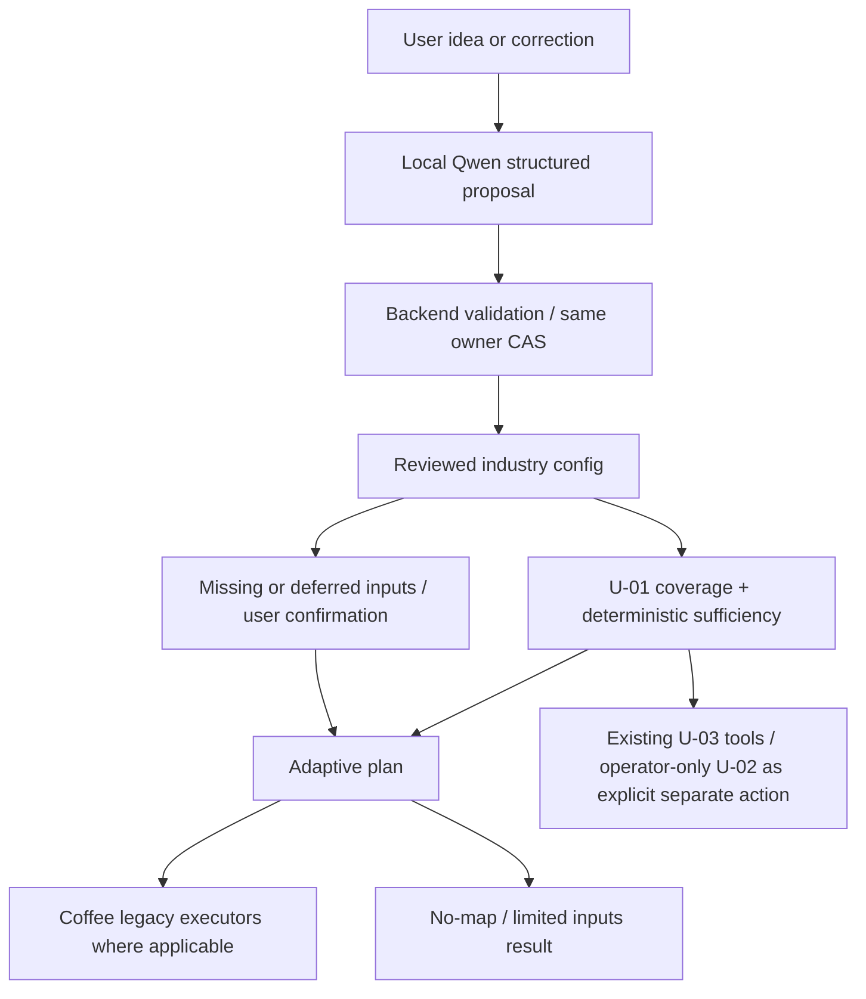

# Business AI 2.0 · U-04: Universal Industry Engine

Implementation: `app/industry/`, `/api/v2/conversations/{id}/industry-profile`,
existing `BusinessFlow` with server-driven stages. U-05 is not implemented.

## Audit and scope

v1 has five fixed fields/questions and strict frozen DTOs. Its location algorithms
already have multiple POI policies, but its UI and financial input template assume
a coffee shop. FinanceRequest.selected_zone is optional; the old frontend required
a selected map candidate before finance. This guard was a UI restriction, not a
requirement of the Decimal engine. U-03 checks metadata/dispatches authorized jobs;
it does not supply an automotive scoring/financial executor.

No geo algorithms, formulas, rounding, banking rules, immutable reports, sources,
network permissions, worker or mascot images/animations were changed.

## ProfileV2 and one lifecycle

`UniversalProfile.schema_version = business-profile-v2`:

- Same profile UUID/conversation UUID and **conversation revision**. There is no
  independently advancing profile counter or new guest identity.
- `idea`: original first description, retained on corrections; `raw_industry`,
  normalized `industry`, `resolution`, quoted `industry_evidence`.
- `values`: common budget/currency, city/service area, business model, premises,
  audience, specialization, format, funding, revenue/cost descriptions, channels,
  constraints/preferences. Unknown fields are absent, never implicit zero.
- `extensions[industry_id]`: validated typed parameters of that configuration.
  Changing industry retains prior extensions without executing their methods.
- Each value: typed scalar, unit, existing DataOrigin, epistemic, review, evidence,
  lineage. Money is a finite decimal string, integers/bools have separate validation.
  Units are assigned by reviewed definitions, not accepted from model/user patches.
- `confirmed_revision`, `deferred_fields`, configuration version/hash/snapshot and
  a complete `legacy_snapshot` preserve review and old preferences/constraints.

Public writes cannot claim observed/source-attested/derived/assumed values. Explicit
user edits/proposals are `user_input/user_provided`; confirmation changes review,
not origin. Existing MetricWithProvenance and financial InputSource are reused, not
replaced. Scenario generation, ranges and an assumption review API remain U-05.

Migration **0011_industry_profile** adds `industry_profiles(profile_id PK/FK,
document JSONB)` with a48KiB object constraint. A profile row is never duplicated;
the FK inherits existing owner binding. The extension is loaded only through an
authorized conversation. A nullable column prototype broke the historical populated
upgrade fixture because old v1 ORM queries selected the new column; the additive
extension table preserves those reads and unchanged old-row fingerprints.

v1→v2 maps known city/category/budget/funding/format and retains the complete v1
snapshot. Unknown v1 categories become generic, not coffee. No general lossless
v2→v1 conversion is claimed. The common-field projection preserves unknown extensions;
only a complete confirmed coffee profile is confirmed for legacy executors. Other
industries remain draft in v1 so its downstream guards cannot treat them as coffee.

Every edit invalidates confirmation/results, including extension-only edits.
v1 edits or U-03 replies advance the same revision: reload reconciles changed common
facts and conservatively clears v2 confirmation. No history/report snapshot is rewritten.

Configuration changes have a hash over reviewed definitions/common fields. A changed
hash invalidates confirmation; explicit parameter save and a new confirmation are
required. Configuration snapshots/version remain in the extension for audit.

## Reviewed configurations and executors

| ID | Required inputs | Optional typed drivers | Geography | Finance |
| --- | --- | --- | --- | --- |
| coffee_shop | city,budget,format,funding | seats,sales/day,average_check RUB/sale | Existing coffee POI proxy within supported coverage | Existing Decimal v1 |
| auto_repair | city,budget,specialization,service_bays,premises | services,utilization,days/month,orders/bay/day,average_order RUB/order,monthly payroll/materials/rent | Applicable; vehicle rating unsupported | Unsupported; input definitions only |
| online_school | budget,audience,format,payment_model,students | tuition RUB/student/payment,payment_frequency,monthly teachers/marketing | Not required, no city/premises question | Unsupported; input definitions only |
| generic | business_model,premises,budget,audience,revenue_streams | common costs/channels/constraints | Depends on premises; no specialized executor | Unsupported |

Definitions are typed local Python configuration, not prompt-owned rules or expressions.
Adding an industry primarily registers a definition and, if needed, a separately
reviewed executable adapter. The extraction schema/catalog derive from the registry.
No claim that configuration alone implements an algorithm. Known adapter IDs are
closed and validated; a model cannot create one by returning its name.

`coffee_inputs` converts only confirmed user average_check/sales_per_day to existing
Amount/Sales/InputSource. The UI uses them only for the base scenario when explicitly
loading editable inputs. Other scenario values remain visibly synthetic inputs;
no pessimistic/optimistic range is invented from a single user value. Existing
template with no v2 driver input is unchanged. All arithmetic stays in Python v1.

## Classification, clarification and safe fallback

One structured IndustryProposal through existing local Ollama transport/H-03 per
message: industry/evidence, bounded field updates/evidence, optional clarification
and supported needs. No native tool-call dependence, additional queue or cloud model.
Context is bounded, current values only; max message1600chars, max14extracted updates,
4096context/768output tokens, one inference attempt. This consumes the same H-03 slot
as old chat; no DB connection is held over queue/inference.

Backend checks IDs, applicable capabilities, types, units, evidence substrings,
observable monetary contradictions and quoted numbers. Known city cases normalize
deterministically. Optional ungrounded paraphrases are excluded independently so
they do not discard a valid classification/budget. Invalid fields stay unknown or
retain their previous value. Unsupported fields/IDs/capabilities reject the proposal.
Malformed/truncated structured output leads to an explicit clarification/manual edit,
not rule-based fake AI or coffee coercion. Transport/queue errors retain their codes.
Evidence/type validation is not proof of truth or robust semantic understanding.

Questions are deterministic: first missing required non-deferred field from the
selected configuration. Already supplied fields are not asked again. Optional fields
can remain absent. “Пока не знаю” explicitly defers a field; once only deferred gaps
remain, the user can confirm known inputs and receive **only a partial result**.
No zero/default and no finance execution is introduced by deferral. An unresolved
industry alternative blocks confirmation until one idea is selected.

## Applicability, data and U-03



`AdaptivePlan` returns profile_revision, config version, missing_fields, next_question,
geo_required, stages, outcome, per-capability status/method/reason and U-01 evidence.
Data coverage, sufficiency, profile summary are real methods. Geo/finance are separate
applicability decisions; unsupported methods do not become executable stages.
No ownerless AnalysisRun is used: this synchronous revision-bound plan has no durable
analysis lifecycle and publishes only after owner/consent/CAS rechecks.

Territory is resolved against the existing registry; an unknown city never falls back
to all territories or Kazan. Required POI/vehicle categories use U-01 directly. Public
user-category metadata does not substitute for private user inputs. Partial coverage,
unknown market quality, freshness and acquisition options stay in the U-01 response.
For online school, no geographic query is made. Private profile data is not published
to the public registry.

U-03 remains the tool gateway for explicit capability/coverage/sufficiency/acquisition
requests. It uses the same conversation revision/consent and existing source registry.
U-04 planning never auto-dispatches imports. Operators must still use the approved
U-03 request envelope/current operator header; guests receive no new rights. Only
OSM POI can be acquired; vehicle graph, traffic and other category downloads remain
unsupported. Whole Moscow is not imported or declared supported.

## API and minimal UI

Feature **BA_INDUSTRY_ENABLED=0** by default (Compose/.env.example). Apply migrations
to a backed-up installation through the existing upgrade procedure before opt-in.
Set1 on the API and reload the frontend to enable the adaptive flow. Keep one API
worker. Rollback: disable the feature; do not downgrade working data.

- GET `/api/v2/industry-capabilities`: enabled/revision and safe reviewed definitions.
- GET `/api/v2/conversations/{id}/industry-profile`: owner-scoped profile/config/plan.
- PATCH same route: `{expected_version,industry?,raw_industry?,updates:[{field,value}],defer_fields:[]}`.
- POST `.../messages`: `{expected_version,content}` → UniversalView.
- POST `.../confirm`: `{expected_version}` → confirmed view or409incomplete/conflict.

Conversation creation, guest credential, consents and history reuse v1. New routes
require the same X-Conversation-Token and active assistant consent. No credentials,
source URLs, SQL, paths, financial adapters or claimed permissions are accepted in
patches/proposals. Changes during inference/consent revocation prevent late publication.
Disconnect/cancellation waits for transaction cleanup. DTO/body/storage limits apply.

Frontend reads actual server stages. Coffee can enter location/finance; if no suitable
coverage, finance may use its supported zone-less API. Online school skips map and
unsupported finance to an honest partial input result; generic/auto likewise expose
only available work. Returning/editing/reload use server revision/confirmation; old
analysis state and mounted modules are invalidated on edits. MapLibre remains lazy.
No landing/mascot redesign. Existing legacy mode remains available when feature is off.

Non-coffee JSON downloads are a current server profile/plan projection (“вводные”),
**not an immutable business-plan report or financial forecast**. v1 PDF/JSON generation
is unchanged for supported coffee results; no static substitute PDF is created.

Example operator-independent patch:

```json
{"expected_version":0,"industry":"auto_repair","updates":[
  {"field":"city","value":"Москва"},
  {"field":"budget","value":"8000000"},
  {"field":"service_bays","value":4}
]}
```

Next question: specialization; no repeated city/budget/bays question. The resulting
data check may show POI/roads missing without preventing a partial input workflow.

## Verification and known limits

Evidence: `docs/qa/u-04/`. Browser scenarios explicitly mock APIs and use recorded DTOs;
PostGIS/API tests separately exercise actual persistence/CAS/ownership/migrations.
Live Qwen uses a disposable empty QA database and no acquisition worker/network fetch.
Initial/debug failures are retained separately; malformed protocol output is injected
in deterministic fault tests, while live adversarial wording is a separate probe.

Actual v1 OpenAPI diff covers route definitions and recursively reachable schemas,
including extra-forbid:36paths/126schemas unchanged, not only equal counts.
Populated migration regression checks old-row fingerprints and immutable report bytes;
no user database downgrade or working-volume modification is performed.

Live/model latency and completed check counts are recorded in HANDOFF/delivery report.
Hardware: local Qwen4B on RTX3050Ti4GB/16GB RAM. Measurements are serial samples, not
SLA or evidence for full-city processing. Qwen can still omit/misclassify facts; explicit
review/manual editing and generic/partial outcomes remain necessary. Textual premises
evidence is conservative, not an independently verified property constraint.

U-05 must add reviewed scenario ranges/assumption confirmation and financial executors
for auto/digital/generic businesses. Do not silently reuse coffee revenue/cost models,
promote confirmed assumptions to observed facts, add missing-source synthetic fallback,
or expand operator network permissions. U-05 requires separate owner authorization.

### Фактически выполненные проверки U-04 · 30.10.2026

- Backend targeted regression117PASS135.33s: industry, registry, agent,
  conversations, H-03 lifecycle, reports, migrations/populated upgrade. Включает
  owner/consent/CAS, late result, no held DB connection, сохранность report bytes.
- Final industry unit29PASS1.92s, включая null/array/deep/wrong-shaped LLM envelopes.
  Наборы пересекаются; их числа не суммируются.
- Vitest66PASS до добавления recovery-теста; final targeted UI14PASS5.42s,
  включая явное повторное согласие без пустого message. Полный набор проверяет prek/CI.
- Chromium full run45PASS/1failure: legacy bank mock не перехватывал новый catalog.
  Фикстура исправлена; bank +4industry scenarios5PASS18.3s. Full suite —46сценариев.
- Real browser online-school flow1PASS32.9s: built Compose/API/PostGIS + Qwen,
  без mocks, classification28.483s, review/confirmation/no-map/reload/JSON;
  console errors0, geo/finance requests0, screenshots1440/768/390.
- Strict v1 actual recursive OpenAPI diff36paths/126schemas unchanged.
- Native classifier live matrix9requests: first39.968s, subsequent2.266…9.890s;
  peak Python RSS108040192bytes (~103.04MiB), GPU-used snapshot2354MiB including
  other GPU usage. No CPU/full Ollama RAM/system peak/SLA measurement.
- TS/ESLint/build PASS; initial JS232.00kB, MapLibre remains lazy. Existing large
  Locations chunk warning remains. Hardened Compose/tmpfs smoke healthy/PostGIS3.6,
 4industry configs/default disabled/web200/0persistent volumes.

Initial failed classifier trials remain in live-qwen-initial.json/debug.json. A live
request to emit invalid JSON still produced schema-valid JSON; malformed protocol
behavior is proven by fault injection, not falsely reported as a live malformed reply.

Reproduction (repository root, pinned dependencies already installed):

```powershell
uv run --locked --project apps/api pytest -c apps/api/pyproject.toml apps/api/tests/test_industry.py -q
npm --prefix apps/web run typecheck
npm --prefix apps/web run lint
npm --prefix apps/web run test
npm --prefix apps/web run build
npm --prefix apps/web run test:e2e -- --grep 'U-04|demo catalogue'
```

For PostGIS tests set PG* to an isolated QA server and BA_RUN_DB_TESTS=1. The test
helpers create/drop only random test databases; do not point at a working installation.
Run tests/integration/test_industry.py plus registry/agent/conversations/reports/
migrations/populated_upgrade; actual geo/candidates/ranking regression18PASS11.64s.
Final dedicated industry integration rerun includes persisted Ollama mode after reload,
configuration revisions, consent, CAS and malformed protocol recovery. UI recovery tests
cover explicit regrant without an empty message and retrying a failed capability catalog.

Real browser: an **isolated** migrated Compose project with BA_INDUSTRY_ENABLED=1,
LLM_PROVIDER=ollama and the approved existing local endpoint/model, then set
BA010_REAL=1, BA_U04_REAL=1, BA_TEST_WEB_URL to that project's web URL and run
`npm --prefix apps/web run test:e2e -- --grep 'U-04 real'`.
No interception/model mocks are used in this opt-in test. Never enable import rights
or update a working Docker volume just to run it. Native model probe:
`uv run --locked --project apps/api python -m tests.integration.u04_live --output docs/qa/u-04/live-qwen.json`
with PYTHONPATH=apps/api and the same isolated PG* environment.
