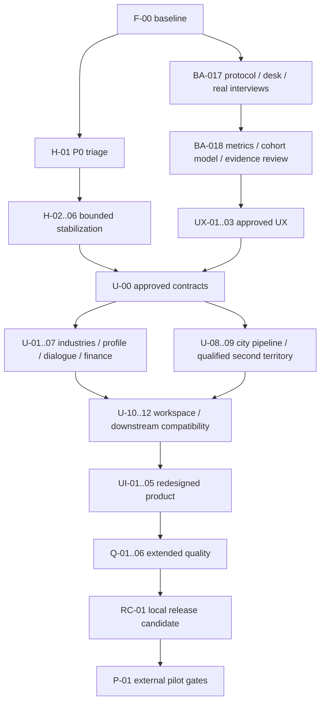

# Business AI · Post-MVP Master Roadmap

**BA2/U-05,30.10.2026:** после mergePR35 разрешены финансовые сценарии и review
гипотез. [Реализация/проверки/ограничения](../architecture/BUSINESS_AI_2_FINANCIAL_SCENARIOS.md).
Статус исполнения в HANDOFF; live Qwen пока blocked. Старые roadmap-v1/U-ID и
их статусы сохранены; это не разрешение U-06 и не закрытие release baseline.

Версия: **v1**, 25.10.2026 (МСК). Roadmap утверждён владельцем после PR #17;
разрешена F-00. Текущий статус исполнения — [HANDOFF](../HANDOFF.md).

**BA2/U-04,30.10.2026:** разрешён Universal Industry Engine после mergePR34.
[Реализация и проверенные границы](../architecture/BUSINESS_AI_2_UNIVERSAL_INDUSTRY_ENGINE.md).
Это отдельный этап BA2, не изменение старых U-ID/статусов. U-05 не начат и требует
нового разрешения владельца. Результаты/PR/CI — в HANDOFF и отчёте передачи.
**BA2/U-03,29.10.2026:** владелец разрешил ограниченный Qwen Tool Agent после mergePR33.
[Реализация и проверенные границы](../architecture/BUSINESS_AI_2_QWEN_TOOL_AGENT.md).
Это не выполнение старой одноимённой карточки нормализации городов и не разрешение U-04.
Владелец/разработчик: один человек с Codex, WIP=1. Никаких дополнительных AI-агентов.

Этот документ детализирует последовательность, но не заменяет
[PROJECT_PLAN](../PROJECT_PLAN.md), F0–F5, инварианты или принятые ADR.
Изменения контрактов ниже — предложения: U-00 требует отдельного утверждения ADR.
Merge этого planning PR не означает разрешения выполнить весь backlog.
Номер PR не равен BA-ID; этот PR **не является выполнением BA-017/018**.

Сопутствуют только два документа: [QUALITY_GATES](QUALITY_GATES.md) — переиспользуемые
проверки; [RISK_REGISTER](RISK_REGISTER.md) — живые дефекты/внешние блокеры.
Зависимости и календарь находятся здесь, отдельный DEPENDENCIES.md не нужен.

**Решение владельца, DESIGN-01 (27.10.2026):** после PR26 приоритетом стал
работающий hackathon frontend — практическая композиция UX-01/02 и основы UI-01.
[Результат и границы](../design/DESIGN-01_PRODUCT_UI.md). Содержание карточек не
переписано, все UX/UI не объявляются завершёнными. H-FINAL не начат; security
release baseline остаётся OPEN. BA-017/018 сохраняются отдельным исследовательским
треком, выполнение последующего backlog требует нового разрешения.

**Решение владельца, Business AI 2.0 (28.10.2026):** разрешён отдельный архитектурный
этап U-00 новой семиэтапной инициативы. Его [контракты](../architecture/BUSINESS_AI_2_UNIVERSAL_ARCHITECTURE.md)
и [сопоставление ID](../architecture/BUSINESS_AI_2_IMPLEMENTATION_PLAN.md#1-конфликт-id-и-старого-roadmap)
используют обозначения `BA2/U-00…06` и `roadmap-v1/U-00…12`, чтобы не смешивать разные
карточки. Карточки, их названия, старые зависимости и статусы ниже не переименованы
и не объявлены выполненными. Это не разрешение U-01, не закрытие исследований или
release security baseline. Технические решения U-00 — на review в ADR-0013.

**29.10.2026:** владелец подтвердил принятие ADR0013/merge PR31 и разрешил только
BA2/U-01 Data Registry & Coverage. [Реализация и границы](../architecture/BUSINESS_AI_2_DATA_REGISTRY_IMPLEMENTATION.md).
Старый roadmap-v1/U-01 IndustryDefinition не объявляется выполненным. U-02 требует
отдельного разрешения; research/release gates сохраняются.

## 1. Фактическая точка старта

**29.10.2026 / BA2/U-02:** после merge PR32 владелец разрешил bounded acquisition.
[Реализация/источники/измерения](../architecture/BUSINESS_AI_2_DYNAMIC_ACQUISITION.md).
Это не выполнение старых одноимённых карточек, sustained public import или разрешение U-03.

- PR #16 действительно merged 25.10.2026 в 15:47 UTC (18:47 МСК).
  Main: `09f2f7d8f8fd7260b72e57b42e51758eb6ada488`; локальный main обновлён ff-only,
  main…origin/main=0/0; исходное рабочее дерево чистое.
- Ветка планирования: `codex/post-mvp-master-roadmap`.
- [CI merged main](https://github.com/1nc-0gn1t0/Business_AI/actions/runs/40208572389) — success.
  HANDOFF BA-016 ещё предлагал проверить/объединить PR: это устаревший статус, не новая задача.
- В этом исследовании прочитаны README, PROJECT_CONTEXT/PLAN/WORKFLOW/HANDOFF,
  ADR-0001…0011, модульные API/DTO/ORM/миграции, frontend lifecycle, Compose/CI,
  существующие тесты и raw BA-016. Проверялись код и результаты, не только HANDOFF.
- Текущие read-only HTTP: API/PostGIS healthy, `kazan-centre`: 23 852 POI,
  8 полигонов, data_version 44157bdc…, stale=false. Readiness с demo — 7/7 PASS.
  Не импортировались новые данные, не менялись volumes/системные сертификаты/модель.
- Базовое доказательство BA-016: 352 API + 72 Postgres/PostGIS + 35 Vitest = 459 именованных
  проверок, из них 453 обычных и 6 property suites; 1550 сгенерированных examples отдельно.
  Browser 18 mock + 3 real. Это сохранённые результаты и CI; live Qwen/полный E2E заново
  ради планирования не запускались.
- Qwen 4B Q4_K_M: 61 уникальный диалог/25 multi-turn; final raw 120/123 шага,
  после отдельно записанной ошибки oracle 121/123. Два открытых model defects D-01/02.
  Это не общая оценка точности всех предпринимательских запросов.

### 1.1 Что есть на самом деле

Обозначения: **A** — реализовано и подтверждено кодом/тестовыми доказательствами;
**B** — частично; **C** — отсутствует; **D** — нужен локальный пересмотр;
**E** — результат зависит от внешних данных/доступа. Несколько статусов допустимы.

| Область | Статус, проверенная реализация | Пробел / доказательство в коде |
|---|---|---|
| Архитектура/API | A: FastAPI modular monolith, typed REST, React 19/TS/Vite/MapLibre | [main](../../apps/api/app/main.py), [API modules](../../apps/api/app/api); не микросервисы |
| DTO/provenance | A/B: frozen extra-forbid, DataOrigin, typed money/source | [schemas](../../apps/api/app/api/schemas.py): общий NonEmptyText без max; ProfilePatch ограничен отдельно |
| ORM/Alembic | A:8 последовательных миграций, constraints, indexes, transactions | [models](../../apps/api/app/db/models.py), [migrations](../../apps/api/migrations/versions); populated upgrade/restore ещё не доказаны как эксплуатационный процесс |
| Диалог/сессии | A/B: PostgreSQL messages/revisions, token hash, constant-time owner check, CAS/lock | [Conversations](../../apps/api/app/services/conversations.py); нет аккаунтов/восстановления потерянного guest key/TTL policy |
| LLM | A/B: Ollama adapter, schema/evidence validation, безопасные errors, single whitelisted extraction tool | [llm.py](../../apps/api/app/adapters/llm.py); не автономный planner с подключёнными geo/finance tools; ответы/вопросы в значительной части формирует домен |
| Извлечение | B/D: city/category/budget/funding/format; обязательный review | [domain](../../apps/api/app/domain/conversation.py), [eval](../LLM_EVALUATION.md); D-01/02, валюта только RUB, словесные суммы семантически зависят от Qwen |
| OSM | A/B: reproducible offline import, snapshots/SHA/ODbL, spatial API | [geo](../../apps/api/app/geo); загружена часть одного города, не весь мир/вся Казань |
| Кандидаты/score | A/B: grid/disperse, coverage, weights/min-max, explainability | [policy](../../apps/api/app/geo/candidate_policy.py), [scoring](../../apps/api/app/geo/scoring.py):5 hardcoded групп coffee/bakery/restaurant/salon/grocery, не общий IndustryRegistry |
| Walking | A/B: OSM node topology, bounded Dijkstra, access/barriers, baseline/network | [walk_graph](../../apps/api/app/geo/walk_graph.py), [walking](../../apps/api/app/geo/walking.py); не автомобильная/indoor/temporal навигация; snap/coverage ограничения |
| Источники | A/B/C/E: OSM/Synthetic работают, GHSL/Licensed — not_integrated | [providers](../../apps/api/app/data/providers.py); нет лицензированных коммерческих фактов/демографии/спроса |
| Финансы | A/B: Decimal64/HALF_UP,3 сценария/BE/sensitivity | [engine](../../apps/api/app/finance/engine.py); фиксированные виды затрат, нет налогов/loan schedule/payback/cash flow; один coffee template |
| Банковский подбор | A/E: deterministic AND/unknown rules,6 demo products, catalogue versions | [matching](../../apps/api/app/bank/matching.py), catalogue.json: demonstration/unconfirmed/cached_only; действующие тарифы/eligibility не подтверждены |
| Согласия/заявка | A/B/E: отдельные purposes, revoke/versions, preview, idempotency, atomic receipt/audit | [leads](../../apps/api/app/leads); mock only, не WORM/юридическое соответствие/банковская CRM |
| Export | A/B: owner snapshot + JSON/PDF/SHA/stale, локальные шрифты | [reporting](../../apps/api/app/reporting), [API](../../apps/api/app/api/reports.py); мягкие deadlines, limits не заменяют global quotas; PDF/UA не сертифицирован |
| Сохранение анализа | B/C/D: report snapshots сохраняются; AnalysisRun table/DTO есть | В live app нет создания AnalysisRunRecord для geo/finance; Finance/выбранная зона/BankingNeeds в React state, reload теряет их. Нельзя называть это полным workspace |
| UI | A/B/D: реальный общий flow, empty/error/mobile390 | [App](../../apps/web/src/App.tsx):4tabs и общий map-first контур; нет условного отраслевого маршрута, подтверждённого UX исследования/design system |
| QA/эксплуатация | A/B/C: prek,2 OS,PostGIS,Chromium,live eval,manifest/readiness | [CI](../../.github/workflows/ci.yml):нет Firefox/WebKit, mutation/security scanner jobs, soak/restore/rollback runbooks; не production-ready |

**Сильные стороны:** разделены понимание/детерминированные расчёты; реальные открытые
геоданные отделены от предположений; инварианты владеющей сессии/согласий защищены
сервером; immutable snapshots/fingerprints позволяют развиваться без переписывания
истории; небольшая локальная инфраструктура соответствует одному разработчику.

**Что нельзя подтвердить сейчас:** market fit, действующие коммерческие цены/спрос,
условия и маржа ВТБ, рост конверсии/капитализации, корректность всех OSM на местности,
юридическая готовность согласий, bank API/права на бренд. Это E, не «скоро готово».

## 2. Решение по последовательности

Сохраняется исходная гипотеза пользователя с тремя уточнениями:

1. Подготовка интервью начинается сразу после фиксации MVP, до окончания triage:
   ответ людей имеет календарный lead time. Это лёгкая координация владельца,
   а не второй тяжёлый workstream или разрешение агенту писать людям.
2. Ранний аудит ограничен P0/целостностью и фиксацией рисков. Остальная H-полировка
   выполняется после BA-017/018; не тратим неделю на CSS/проценты покрытия до дедлайна.
3. UX сначала задаёт journeys и capability/component contracts. Внутренние отраслевые
   и city contracts утверждаются до API/нового UI; visual refactor следует после них.
   Финальная тяжёлая QA проверяет уже расширенный продукт, но каждый PR тестируется сразу.

| Этап | Задачи / выход | Оценка focused days, не календарное обещание |
|---|---|---|
| 0 · baseline | F-00, immutable checkpoint/реестр рисков |0.5|
| 1 · ранний triage | H-01; доказанный P0 → минимальный H-02 fix немедленно |0.5–1 + отдельная оценка P0|
| 2 · первый спринт | BA-017-01…04, BA-018-01…03, проверка владельцем |4–5 до 31.10|
| 2b · стабилизация | оставшиеся H-02…06, подготовка архитектурных контрактов |6–10|
| 3 · UX | UX-01…03, journeys/prototype/owner approval |3–5 + ожидание людей|
| 4 · универсальность | U-00…12, 4 основных отрасли и 2 bounded territories |16–25|
| 5 · UI | UI-01…05, внедрение по одному вертикальному шагу |8–12|
| 6 · комплексное качество | Q-01…06, внешний доступ по-прежнему закрыт |8–12 + 8 ч soak|
| 7 · RC | RC-01, воспроизводимый release и rollback evidence |2–3|
| внешний pilot | P-01/канонические BA-019…022 |зависит от договоров/банка, не оценено|

Первый локальный RC: ориентировочно 50–75 focused days по 4–5 ч + 25% резерв,
то есть примерно 13–19 рабочих недель при стабильных 20–25 ч/неделю. Это предварительная
оценка, после UX/U-00 пересчитать по факту. Не обещаем RC к 1 ноября.
`недели = оценённые часы / фактические доступные часы в неделю ×1.25 + внешние ожидания`.
Указанные интервалы не суммируются с повторно учтёнными подзадачами/резервом.

### 2.1 BA-017/018 до 1 ноября 2026

План начинается 26 октября, понедельник. Принимаем 23 focused часа на 26–30 октября,
до 4 ч резерва 31 октября. Это **плановая доступность, владелец должен подтвердить её**.
Внешний срок интерпретируется строго: материалы переданы до 23:59 МСК 31.10,
1 ноября оставляется для подачи/демонстрации, не написания выводов.

| Дата | Один основной результат дня | План часов |
|---|---|---:|
|26.10|F-00(1.5 ч), BA-017-01 protocol/recruitment(1.5 ч), H-01 triage(2 ч)|5|
|27.10|BA-017-02 desk evidence(2 ч), первые интервью/обезличенные заметки BA-017-03(2 ч)|4|
|28.10|оставшиеся интервью(1 ч), BA-017-04 synthesis(1.5 ч), BA-018-01 KPI/denominators(1.5 ч)|4|
|29.10|BA-018-02 сценарная cohort model(4 ч), независимая сверка(1 ч)|5|
|30.10|BA-018-03 sensitivity/experiment/limitations(2 ч), human review обоих пакетов(2 ч), исправления(1 ч)|5|
|31.10|резерв: перенос интервью, ошибки/проверка источников/финальный пакет; новое scope не брать|до 4|

Цель интервью: 3 реальных участника (2 потенциальных основателя разных типов бизнеса,
1 недавно открывшийся предприниматель), 30 мин + краткая фиксация; выводы качественные,
не репрезентативная статистика. Владелец приглашает/проводит/подтверждает записи.
Агент готовит протокол, форму заметок, источники/таблицы и код сценарной модели;
не делает вид, что интервью состоялись, не связывается с людьми без отдельного поручения.

Если 26.10 нет подтверждённых участников — заранее предложить 2 резервных кандидата.
Если до 29.10 интервью не состоялись — оформить честный desk-only пакет и открытый
blocker BA-017-03; **BA-017/Research Ready полностью не закрывать**. Материалы срока
могут быть частичными с явным disclosure. В банковской модели неизвестная маржа
остаётся параметром/unknown: отсутствие банковских доступов не мешает честной BA-018.
P0 fix, занявший более 2 ч/утверждение позже 26.10, требует в тот же день пересмотра scope
и сообщения о риске дедлайна; не выдумываем evidence ради сроков.

## 3. Предлагаемые архитектурные границы

Все изменения ниже осуществляются позже, после U-00/одобрения. Остаются монолит,
одна PostgreSQL/PostGIS, локальная Qwen, существующие typed API/DTO/provenance enums.

### 3.1 Отраслевые capabilities вместо копий продукта

Версионируемый локальный `IndustryDefinition` (JSON + Pydantic validation, без eval):
`id/revision/aliases/location_dependence/supported_modules/required_fields`,
anchors/competitors/complementary/metric policy, finance_template_id,
источники/допущения/ограничения/уровень support. Fingerprint эффективного config
входит в результаты. Поддержка каждого модуля: supported/experimental/not_applicable/
unavailable; это не одно bool «поддерживается отрасль».

| Отрасль | Сейчас | Первая Beta / ограничения |
|---|---|---|
| Кофейня | полный проверенный demo flow, OSM proxies/coffee template | первая regression/reference отрасль; помещение/спрос не подтверждаются |
| Пекарня | geo policy есть; finance только coffee example | собственные scenario inputs/production costs; мощность/вентиляция/зонирование missing |
| Барбершоп | Qwen распознаёт, точного alias/config нет | service-capacity assumptions, hairdresser context с оговоркой о широте OSM категории |
| Онлайн-магазин | распознаётся, специального маршрута нет | no-map path, orders/COGS/delivery/platform/marketing inputs; склад/пункт выдачи только по отдельному выбору |
| Ресторан | geo policy есть, отраслевое качество не доказано | следующий P2 config после первых 4: кухня/посадка/мощность/разрешения; не копия кофе |
| Продуктовый магазин | geo policy есть, финансового retail template нет | следующий P2: inventory/turnover/shrinkage assumptions; cash flow нельзя обещать по простой operating model |
| Автосервис | generic текст/финансы с явными вводными, нет geo policy | unsupported/experimental: car access, помещение/энергия/санусловия не доказаны; walking не автомобильная доступность |

Первая Beta проверяет coffee/bakery/barber/online. Ресторан/grocery — расширение
того же registry отдельными небольшими PR после RC или по явному reprioritization;
автосервис не объявлять supported без нужных данных/критериев. Добавление конфигурации
не делает коммерческие предположения фактами.

### 3.2 Профиль, деньги и география

- В v1 сохраняются category/city strings и RUB budget. Новые industry_id/revision,
  city_ref и capabilities добавляются совместимо; сервер разрешает canonical refs,
  модель их не назначает произвольно. Старые profile/report snapshots читаются прежним parser.
- CityRef: stable ID, country/region/display name/aliases; опечатка даёт кандидат/вопрос,
  не незаметное исправление. Нельзя выбирать город по наличию данных под желаемый ответ.
- Валюта: хранить отдельно исходный amount/currency как пользовательский ввод;
  financial v1 получает RUB только после явного выбора/подтверждённого пересчёта.
  До отдельной FX policy не подключать live курсы и не конвертировать автоматически.
  Иностранная валюта не должна стирать отдельно названный город.
- CityDatasetRegistry фиксирует поддержанную территорию/границу и **отдельное**
  покрытие POI/graph/admin по версиям/датам. City support не равен full-city coverage.
  Первый дополнительный extract — часть Самары, а не обещание поддержки всей Самары.
- Импорт остаётся операторским: resolve territory → bounded fetch → validate →
  offline import → graph build → QA → atomic activation. Ограниченные bbox/bytes/elements/
  edges/time/disk; новая область/запрос — новый slug. Пользовательский запрос не запускает Overpass.
- Сначала ручной локальный city registry/официальные OSM IDs. Public Nominatim не
  превращать в autocomplete; его policy отдельно ограничивает использование.

### 3.3 Финансы, workspace и совместимость

Расчёт v1 сохраняется и не получает OSM-score как коэффициент выручки. U-06 предлагает
отдельную v2-оболочку с typed line items и отображением в проверенное арифметическое
ядро там, где значения эквивалентны. Согласовать no double-count rules, service/order
units, fixed/variable costs, ограничения capacity/stock. Налоги, кредитный cash flow
и окупаемость не добавляются исподволь. Невыразимый показатель → explicit unsupported.

Вместо новой БД/микросервиса использовать существующий AnalysisRun как основу
owner-scoped workspace: conversation/profile version, industry/city/data/algorithm
bindings, validated inputs, выбранные результаты/зона и status current/stale.
Нужны новые nullable columns/JSONB envelopes и индексы; точные миграции — U-02/U-10.
Номер следующей миграции не резервировать до feature-ветки. Сначала expand/backfill
проверенных nullable refs, затем writers/readers; contract/drop — отдельное решение.

Предлагаемый additive API: `/conversations/{id}/analyses` и finance drafts;
существующие stateless geo/finance endpoints не удаляются. Не дублировать большие
графы без лимита: хранить bounded snapshots/result references и их hashes.
Не ссылаться на mutable active version. Report snapshots v1 immutable; новый renderer/
snapshot version только явно. Lead draft пересогласуется после любой relevant revision.

Сначала консервативная invalidation: profile/config/source/input change помечает
зависимые результаты stale. Детальную оптимизацию «funding не влияет на geo» вводить
только после тестирования dependency projections. Обновление city не может оставлять
старую Казань актуальной; выбор зоны сам по себе не меняет финансовый прогноз.

## 4. UX и визуальное направление

Предложенная navigation: **Идея → Проверка профиля → Локации (если применимо) →
Экономика → Сравнение/резюме → Банковские возможности (optional) → Отчёт**.
Consent/mock lead — отдельная добровольная ветка, не обязательный финал отчёта.
Чат помогает на каждом шаге; state/progress важнее размещения всех панелей одновременно.

- Onboarding объясняет support/данные/демо; consent цели не объединяются.
- До запуска показывать «что известно/что нужно уточнить/чего нет»; manual edit и back
  сохраняют черновики, а stale результаты объясняются до пересчёта.
- Рейтинг: сырые counts, distance method, cohort, weight assumptions, source/date,
  missing; названия для человека, технические fingerprints по раскрытию.
- Финансы: editable assumptions + units/source badges, сначала итог/разница с budget,
  затем costs/scenarios/sensitivity; предупреждение о неучтённых статьях рядом.
- Mobile: один рабочий шаг и доступный список зон вместо обязательной карты;
  layout без горизонтального drag для важных решений. Ошибка содержит recovery action.
- Component contracts в UX-02: ProfileReview, CapabilityNotice, AnalysisStepper,
  SourceBadge, ZoneComparison, ScenarioEditor, ConsentPanel, ReportActions;
  inputs/outputs/loading/error/empty/stale/keyboard states, не новый framework.

### 4.1 Что удалось проверить по официальным источникам ВТБ

25.10.2026: [официальная страница малого бизнеса](https://www.vtb.ru/malyj-biznes/)
доступна через поисковое представление: направления по потребностям и тематическим
этапам бизнеса. [Официальная инструкция ВТБ Онлайн](https://www.vtb.ru/personal/karty/help/personal/vklady-i-scheta/help/personal/online-servisy/)
описывает разделы/виджеты/поиск, тёмную тему и доступность. Это полезные UX-референсы,
не набор лицензированных компонентов и не доказательство качества нашего UI.
[Официальный материал о guideline](https://kdelu.vtb.ru/articles/gajdlajn-chto-eto-i-kak-on-pomogaet-brendu/)
объясняет назначение правил, но **не является брендбуком ВТБ**.

Прямой browser доступ к vtb.ru и kdelu.vtb.ru вернул CERT_AUTHORITY_INVALID,
web-open — timeout/502. Предупреждения не обходились, сертификаты не устанавливались.
Следовательно **актуальные визуальные токены, точные цвета, VTB fonts и права на logo
не проверены**. UX-03 должен получить актуальный approved reference/brand permission
через владельца либо оформить независимую визуальную систему без банковских активов.
Не называть предположения официальным стандартом.

Предложение для Business AI: restrained blue/white/graphite surfaces, один синий
primary action, бирюза для маркировки продукта/позитивного состояния, читаемая
аналитическая типографика/таблицы. Это **наш проектный выбор**. Предварительно light
theme для таблиц/печати; текущий dark сохранить до безопасной миграции. Вторая полноценная
тема — P2 после одного проверенного accessible варианта: одному разработчику не стоит
удваивать visual-test matrix заранее. UI не копирует logo, шрифт, иллюстрации или
платёжные/банковские статусы. Постоянно видна принадлежность Sab0tage и demo status.

## 5. Зависимости и контрольные состояния

Ветки I/C на схеме означают независимые зависимости, **не параллельную работу**.
Один разработчик делает I, затем C, затем W. Критический путь:
F-00 → BA-017 реальные данные → BA-018 → UX approval → U-00 → profile/industry/finance →
city qualification → workspace/downstream → UI → deep QA → RC.
H-01 выявленный P0 вклинивается немедленно; H-02…06 должны завершиться до U-00.
No-data online path не ждёт второго города, но вся Beta-веха ждёт U-09.

| Состояние | Объективное условие / сейчас |
|---|---|
| Current Functional MVP | достигнуто в локальном scope 09f2f7d: BA-001…016/CI, известные D-01/02 и demo ограничения опубликованы; не market-ready |
| Architecture Stabilized | H-01…06 закрыты, U-00 ADR/версионные контракты утверждены, populated migration/restore evidence; пока не достигнуто |
| Research Ready | BA-017-01…04 с 3 реальными интервью/аудитом evidence, BA-018-01…03 с проверенной сценарной моделью; нет приписанной банку эффективности |
| UX Validated | UX-01…03, ≥3 проверки основных заданий, owner approves journey/component/state contracts; brand limits записаны |
| Multi-Industry/Multi-City Beta | U-01…12: 4 основных отраслевых пути + 2 квалифицированные частичные территории, provenance/old snapshots/API compatibility; не полная F3 коммерческая data readiness |
| Redesigned Product | UI-01…05, новые шаги без сломанного старого flow, доступные альтернативы карте/графикам, approved visual system |
| Quality Verified | Q-01…06/QG, 0 открытых P0; каждый P1 закрыт либо ограничен/принят владельцем с датой; raw FAIL/SKIP сохранены |
| Release Candidate | RC-01: immutable build/data manifest, полный reproducible demo, rollback/restore, docs/CI и scope/known limitations подписаны владельцем |
| Pilot Ready | P-01 + внешние privacy/security/legal/brand/data/API approvals, согласованный auth/operations/experiment; локальный RC сам этого не даёт |

## 6. Атомарный backlog

Карточки ниже — спецификации на момент планирования; историческое «сейчас» не
засчитывает задачу. F-00 подготовлена к приёмке, остальные задачи не начаты;
проверки/фактический статус — в HANDOFF и baseline, не выполнение всего backlog.
Оценки — focused developer hours с Codex, без внешнего ожидания и общего 25% резерва.
S≤4 ч, M≈4–10 ч, L≈10–16 ч, XL>16 ч требует предварительного дробления.
Каждая карточка — один небольшой PR; если оценка превышена/дифф слишком велик,
до кодирования создать под-ID `.a/.b` с отдельными acceptance и зависимостями,
не смешивать несвязанные изменения. Ни один XL implementation PR не запланирован.
Для каждого PR действует QG-PR; в строке тестов указаны дополнительные проверки.

### F-00 · Зафиксировать проверяемую исходную версию

- **Цель:** иметь точку сравнения и восстановления перед изменениями.
- **Сейчас:** merged main/CI и BA-016 artifacts есть; контрольный post-MVP manifest ещё не принят.
- **Работы:** сверить HEAD, CI и readiness; записать SHA, версии модели/данных/образов, ограничения и checksum артефактов; предложить контрольный tag без автоматического release.
- **Подсистемы:** Git, demo manifest, документация.
- **Зависимости:** нет; требуется разрешение начать выполнение roadmap.
- **Приоритет:** P0 организационный. **Сложность:** S, 1–2 ч.
- **Риски:** принять исторические PASS за новый запуск; записать секрет в manifest.
- **Тесты:** read-only readiness, существующий smoke, проверка ссылок/hash; версии без токенов.
- **Приёмка:** один воспроизводимый manifest связывает main, успешный CI, OSM/graph/model и known issues; пользовательские данные не изменены.
- **Документация:** DEMO_GUIDE, HANDOFF, RISK_REGISTER.
- **Для пользователя:** известная рабочая версия демо.
- **Переход:** владелец принял baseline; переход к BA-017-01, затем H-01.

### H-01 · Ограниченный ранний triage безопасности и целостности

- **Цель:** обнаружить release blockers до исследований, не начинать массовую полировку.
- **Сейчас:** BA-016 негативные тесты есть; нового доказанного P0 в этом исследовании нет.
- **Работы:** за 2 ч проверить ownership, согласия, idempotency/CAS, ошибки/секреты и resource limits; воспроизвести подозрения на изолированных данных; классифицировать, не объявлять риск дефектом без доказательства.
- **Подсистемы:** API, сессии, lead/report, DB.
- **Зависимости:** F-00.
- **Приоритет:** P0. **Сложность:** S, 2 ч triage; исправление отдельно.
- **Риски:** scope creep; случайный тест на рабочей сессии.
- **Тесты:** целевые security/regression BA-016 плюс минимальный reproducer каждого нового дефекта.
- **Приёмка:** каждый риск имеет evidence/severity/owner; доказанный P0 блокирует дальнейший release и получает отдельный минимальный fix PR с регрессией. Неподтверждённое не помечено PASS.
- **Документация:** SECURITY_TEST_REPORT, RISK_REGISTER, HANDOFF.
- **Для пользователя:** критические ограничения известны до демонстрации.
- **Переход:** P0 устранены либо работа остановлена; при отсутствии P0 — BA-017/018, затем H-02…06.

### H-02 · Ограничения входных данных и ресурсов API

- **Цель:** ограничить контролируемую клиентом нагрузку и объём хранения.
- **Сейчас:** строгие DTO/частные caps есть; общий NonEmptyText и глобальные квоты неполны.
- **Работы:** инвентаризировать размеры/частоты; ввести конфигурируемые bounds строк/коллекций/body и квоты guest/report с безопасными 413/422/429; сохранить auth/consent checks и v1 semantics допустимых запросов.
- **Подсистемы:** DTO, middleware, conversation/report storage.
- **Зависимости:** H-01; P0 fix не ждёт дедлайна исследований.
- **Приоритет:** P1, доказанный exploit повышает до P0. **Сложность:** M, 6–10 ч.
- **Риски:** заблокировать нормальный длинный профиль; обход лимита другим endpoint/process.
- **Тесты:** границы и параллельные превышения, неверный owner, oversized PDF input, неизменность данных после отказа.
- **Приёмка:** таблица caps покрывает все write API; oversized запрос не вызывает LLM/запись; квота не сбрасывается простым новым запросом; разрешённые текущие DTO проходят.
- **Документация:** API limits, SECURITY_TEST_REPORT, HANDOFF.
- **Для пользователя:** понятные отказы без зависания сервиса.
- **Переход:** QG-PR/QG-SAFE; только после проверки предельных значений.

### H-03 · Изолировать inference от DB-транзакции и ограничить очередь

- **Цель:** медленная Qwen не должна занимать DB connection до конца inference.
- **Сейчас:** row lock берётся после модели, но read transaction остаётся открытой во время вызова; pool impact не измерен.
- **Работы:** короткое чтение immutable context → inference без DB connection → новая транзакция с повторными owner/consent/version checks; один активный inference и малая ограниченная очередь/честный busy status, без Redis/Celery.
- **Подсистемы:** conversations service, Ollama adapter, DB lifecycle.
- **Зависимости:** H-01, H-02.
- **Приоритет:** P1. **Сложность:** M, 6–10 ч.
- **Риски:** TOCTOU, сохранение ответа после отзыва согласия, process-local лимит при нескольких workers.
- **Тесты:** два клиента, edit/revoke во время blocked inference, timeout/cancel, pool occupancy, отсутствие частичных messages.
- **Приёмка:** connection возвращается до inference; stale/revoked ответ не сохраняется; очередь ограничена и deployment assumptions задокументированы; QG-OPS responsiveness проверен.
- **Документация:** ADR дополнение, API busy/retry, PERFORMANCE.
- **Для пользователя:** аналитика остаётся доступна при занятой Qwen.
- **Переход:** целевые concurrency tests и live smoke без регрессии.

### H-04 · Миграция заполненной БД и backup/restore

- **Цель:** доказать восстановимость данных до новых схем.
- **Сейчас:** empty upgrade/downgrade проверены; populated upgrade и реальный restore drill отсутствуют.
- **Работы:** fixture предыдущей поддерживаемой версии с profiles/consents/leads/reports/геоверсиями; upgrade/check; резервная копия и восстановление в другую БД; описать шифрование, хранение ключей, совместимый rollback приложения.
- **Подсистемы:** Alembic, PostgreSQL/PostGIS, operator scripts.
- **Зависимости:** H-01.
- **Приоритет:** P1. **Сложность:** M, 6–10 ч.
- **Риски:** восстановить поверх рабочей БД; скопировать токены в публичные artifacts.
- **Тесты:** counts/constraints/checksums, ownership и PDF после restore, прерывание upgrade на fixture.
- **Приёмка:** команды отказывают рабочему target по умолчанию; восстановление измерено; RPO/RTO targets QG-OPS проверены либо явно не достигнуты; нет удаления volumes и автоматического destructive downgrade.
- **Документация:** BACKUP_RESTORE runbook (новый при реализации), migration policy, HANDOFF.
- **Для пользователя:** возможность вернуть проверенную версию без потери истории.
- **Переход:** успешный drill на изолированной БД.

### H-05 · Безопасная диагностика и готовность сервисов

- **Цель:** быстро отличать сбой модели, БД, данных и UI.
- **Сейчас:** healthz/readiness и safe errors есть; единого ограниченного diagnostic bundle нет.
- **Работы:** request/correlation ID, структурированные события duration/status/version без содержимого диалога; bounded queue/pool/error counters; shallow health отдельно от opt-in deep check; локальный export диагностики с redaction.
- **Подсистемы:** API logging, demo_ready, UI error correlation.
- **Зависимости:** H-02, H-03.
- **Приоритет:** P1. **Сложность:** M, 4–8 ч.
- **Риски:** token/PII leakage; readiness ошибочно заявляет качество inference.
- **Тесты:** sentinel secrets во всех error paths, rotation/bounds, DB/Ollama down и recovery.
- **Приёмка:** для каждого service failure есть различимый код и безопасный recovery; bundle не содержит prompt/token/body; наличие модели и настоящий успешный inference отображаются разными фактами.
- **Документация:** DEMO_GUIDE, диагностические поля/retention, PERFORMANCE.
- **Для пользователя:** полезная ошибка и понятное восстановление.
- **Переход:** QG-SAFE, fault smoke; без обязательной внешней observability платформы.

### H-06 · Проверка зависимостей, лицензий и секретов

- **Цель:** получить контролируемую supply-chain baseline без массового upgrade.
- **Сейчас:** lockfiles и CI есть; отдельные scanner gates не настроены.
- **Работы:** проверить совместимые бесплатные pip-audit/npm audit/secret scanner; зафиксировать версии; отчёт по прямым/транзитивным рискам и лицензиям; включить scoped CI с triage/expiry исключений.
- **Подсистемы:** Python/Node dependencies, Git/CI.
- **Зависимости:** F-00, H-01.
- **Приоритет:** P1. **Сложность:** M, 4–6 ч.
- **Риски:** false positives, неразрешённые сетевые uploads, breaking update ради счётчика.
- **Тесты:** локальный fake-secret fixture без настоящих ключей, clean lock installs, smoke после каждого необходимого patch update.
- **Приёмка:** нет необработанных exploitable critical/high; каждое исключение обосновано владельцем и сроком; реальные .env не загружаются третьим сторонам; лицензии новых dependencies проверены.
- **Документация:** SECURITY_TEST_REPORT, dependency exception register в нём, HANDOFF.
- **Для пользователя:** воспроизводимая сборка с известными ограничениями.
- **Переход:** QG-PR и принятая baseline; без автоматического major upgrade.

### BA-017-01 · Протокол исследования и набор участников

- **Цель:** начать внешнюю зависимость до дедлайна.
- **Сейчас:** есть продуктовые гипотезы, но подтверждённых интервью нет.
- **Работы:** сформулировать вопросы/гипотезы, критерии 3 участников, сценарий 30-минутного интервью, согласие на заметки и обезличенный шаблон; владелец сам приглашает людей.
- **Подсистемы:** продуктовые исследования; код не меняется.
- **Зависимости:** F-00; не ждёт полного H-аудита.
- **Приоритет:** P0 календарный. **Сложность:** S, 1,5 ч + внешнее ожидание.
- **Риски:** наводящие вопросы и недоступность участников.
- **Тесты:** dry run вопросов владельцем, проверка связи вопрос → гипотеза → решение.
- **Приёмка:** протокол утверждён; запросы на интервью выполняет человек; есть расписание либо честный recruitment blocker; лишние ПД не собираются.
- **Документация:** research protocol/assumption log в существующем research разделе, HANDOFF.
- **Для пользователя:** развитие по реальным потребностям.
- **Переход:** протокол принят, desk research можно выполнять без ожидания ответов.

### BA-017-02 · Проверяемое кабинетное исследование

- **Цель:** определить первые сегменты и альтернативы продукту.
- **Сейчас:** репозиторий не доказывает размер рынка/конкурентные преимущества.
- **Работы:** датированные первичные источники; 3–4 сегмента; сравнение банковских порталов, бизнес-планирования, GIS и AI-помощников по одинаковым задачам/доступности/стоимости; неизвестное оставить неизвестным.
- **Подсистемы:** research evidence; без scraping и paid API.
- **Зависимости:** BA-017-01.
- **Приоритет:** P0 календарный. **Сложность:** S, 2 ч на узкий sprint deliverable.
- **Риски:** устаревшие цифры, реклама вместо проверяемого факта.
- **Тесты:** открытие источников/даты/единицы, выборочная ручная сверка каждого числового вывода.
- **Приёмка:** таблица утверждение/источник/дата/ограничение; факты отделены от гипотез; минимум 4 класса альтернатив, без заявления полного TAM при отсутствии данных.
- **Документация:** market/competitor analysis, evidence index.
- **Для пользователя:** обоснованный выбор первых задач и отраслей.
- **Переход:** evidence review владельцем; никаких выдуманных статистик ВТБ.

### BA-017-03 · Реальные качественные интервью

- **Цель:** проверить барьеры выбора локации/финансов/доверия.
- **Сейчас:** синтетические QA-персоны не являются интервью.
- **Работы:** человек проводит 3 интервью (2 планирующих запуск, 1 недавно открывшийся); агент помогает с обезличенным кодированием заметок, не изображает респондента.
- **Подсистемы:** research, privacy of notes.
- **Зависимости:** BA-017-01, добровольное участие людей.
- **Приоритет:** P0 календарный. **Сложность:** S, 3 ч + ожидание.
- **Риски:** recruitment failure; малая выборка; сохранение контактов в Git.
- **Тесты:** наличие реальных дат/согласий/обезличенных свидетельств, проверка цитат человеком.
- **Приёмка:** 3 traceable интервью и ограничения выборки; иначе PARTIAL/BLOCKED с фактическим n, без статистической репрезентативности и выдуманного PASS.
- **Документация:** anonymized interview summaries; контакты/записи вне публичного Git.
- **Для пользователя:** найденные реальные затруднения, а не предположения разработчика.
- **Переход:** человеческая проверка evidence; без неё Research Ready не достигнут.

### BA-017-04 · Синтез гипотез и исследовательский пакет

- **Цель:** превратить исследования в решения для UX/roadmap.
- **Сейчас:** потребности сформулированы предположительно.
- **Работы:** сопоставить интервью и desk evidence; отметить supported/refuted/unknown, выбрать primary segment, 3 главные проблемы и дальнейшие проверки; не расширять объём продукта автоматически.
- **Подсистемы:** research, roadmap priorities.
- **Зависимости:** BA-017-02, BA-017-03.
- **Приоритет:** P0 календарный. **Сложность:** S, 1,5 ч.
- **Риски:** cherry-picking; малую выборку назвать доказанным market fit.
- **Тесты:** каждый вывод имеет evidence ID; contradictory evidence сохранено; независимая вычитка владельцем.
- **Приёмка:** пакет BA-017 соответствует исходному PROJECT_PLAN; факт/гипотеза/неизвестное разделены; scope и ограничения явно приняты.
- **Документация:** research summary, assumption log, HANDOFF.
- **Для пользователя:** приоритеты отражают проверенные проблемы.
- **Переход:** Research часть принята; при нехватке интервью статус частичный, UX допускает только предварительные гипотезы.

### BA-018-01 · Определения KPI и банковской воронки

- **Цель:** измерять ценность, не считать mock receipt банковской конверсией.
- **Сейчас:** реальные данные о банковских продажах/выручке отсутствуют.
- **Работы:** определить единицы user/session/project/cohort, события и знаменатели: активация → подтверждённый анализ → полезный результат → добровольный интерес → demo lead; реальные bank stages вынести как будущие внешние события.
- **Подсистемы:** экономическая спецификация, будущая минимальная telemetry.
- **Зависимости:** BA-017-02; финальные definitions сверить с BA-017-04.
- **Приоритет:** P0 календарный. **Сложность:** S, 1,5 ч.
- **Риски:** двойной учёт повторов, скрытая обязательность маркетинга.
- **Тесты:** ручные примеры 2 сессий одного пользователя, повторных leads, отказа от маркетинга.
- **Приёмка:** у каждого KPI формула/denominator/window/source/unknowns; demo и банковские показатели различимы; никакого нового tracking без отдельного решения.
- **Документация:** BA-018 KPI/funnel specification.
- **Для пользователя:** понятное назначение продукта без скрытой продажи.
- **Переход:** owner review definitions до экономического расчёта.

### BA-018-02 · Сценарная когортная экономика

- **Цель:** оценить условия потенциальной ценности для банка, не выдать её за подтверждённую.
- **Сейчас:** предпринимательский finance engine не является экономикой внедрения ВТБ.
- **Работы:** отдельная прозрачная модель 3 сценариев: привлечение/активация/конверсия/удержание, incremental эффект, затраты разработки/поддержки/железа/электроэнергии/данных; неизвестные bank margin/CAC остаются параметрами с явно сценарными значениями.
- **Подсистемы:** исследовательская экономическая модель; finance engine не менять.
- **Зависимости:** BA-018-01, BA-017-04.
- **Приоритет:** P0 календарный. **Сложность:** S, 4 ч.
- **Риски:** смешение месяца/года, двойной учёт удержания/маржи, local inference назвать бесплатным.
- **Тесты:** cohort ledger, размерности, нулевые конверсии, отрицательный эффект, верхние границы долей.
- **Приёмка:** все исходные числа имеют source или assumption; формулы доступны; эффект incremental, без заявлений об официальной доходности ВТБ.
- **Документация:** BA-018 model, data dictionary, assumptions.
- **Для пользователя:** честное объяснение экономической гипотезы продукта.
- **Переход:** вычисления доступны независимой проверке.

### BA-018-03 · Проверка экономики и план подтверждения

- **Цель:** подготовить проверяемый sprint deliverable до 1 ноября.
- **Сейчас:** пилот/контрольная группа/измеренная эффективность отсутствуют.
- **Работы:** независимая сверка нескольких расчётов, sensitivity/порог безубыточности внедрения, проект контрольного эксперимента с guardrails/окном/критериями остановки; вычитка материалов человеком 30 октября.
- **Подсистемы:** BA-018, research presentation materials (не UI).
- **Зависимости:** BA-018-02.
- **Приоритет:** P0 календарный. **Сложность:** S, 3 ч + owner review.
- **Риски:** сценарную ROI назвать наблюдаемой; не оставить времени на исправления.
- **Тесты:** независимый эталон, ± изменения входов, no-conversion case; links/facts cross-check.
- **Приёмка:** 3 сценария и sensitivity согласованы; отдельно список данных, которые должен предоставить банк; experiment plan не объявлен проведённым; owner sign-off до дедлайна либо честный partial status.
- **Документация:** BA-018 validation/experiment plan, HANDOFF.
- **Для пользователя:** обоснованные материалы для жюри и следующий способ проверить эффект.
- **Переход:** BA-017/018 Research Ready только по фактическим критериям; затем оставшийся H-аудит.

### UX-01 · Условные пользовательские маршруты и навигация

- **Цель:** убрать техническую сложность и обязательную карту для нелокационного бизнеса.
- **Сейчас:** четыре вкладки, общий map-first путь и технические ограничения требуют объяснения.
- **Работы:** journeys для 4 целевых отраслей, неизвестного города/отрасли, возврата/отказа/смены вводных; IA, onboarding, progressive disclosure; определить, когда карта пропускается, а расчёт недоступен.
- **Подсистемы:** UX specification; без UI рефакторинга.
- **Зависимости:** BA-017-04, BA-018-03, H-01.
- **Приоритет:** P1. **Сложность:** M, 4–6 ч.
- **Риски:** ускорить happy path ценой скрытых допущений/обязательной заявки.
- **Тесты:** walkthrough минимум 10 контрастных задач, включая mobile и отсутствующие данные.
- **Приёмка:** у каждого этапа есть вход/выход/назад/ошибка/stale; банк и lead добровольны; export не требует lead consent; owner согласовал IA.
- **Документация:** UX journey/state diagrams, USER_INTERFACE future specification.
- **Для пользователя:** понятный путь от идеи к решению.
- **Переход:** явное утверждение структуры до компонентных контрактов.

### UX-02 · Прототип, usability и контракты компонентов

- **Цель:** проверить понимание до дорогой реализации.
- **Сейчас:** пользовательского UX validation и согласованных component contracts нет.
- **Работы:** low-fi clickable прототип desktop/mobile; 3 человека выполняют задачи; определить props/events/states для ProfileReview, CapabilityNotice, AnalysisStepper, SourceBadge, ZoneComparison, ScenarioEditor, ConsentPanel, ReportActions.
- **Подсистемы:** UX, frontend contracts; прототип явно не live продукт.
- **Зависимости:** UX-01, H-05.
- **Приоритет:** P1. **Сложность:** M, 6–10 ч + внешнее ожидание.
- **Риски:** нарисовать API, которого нет; тестировать только владельца.
- **Тесты:** completion/ошибки/понимание источников и mock статуса; keyboard/mobile walkthrough.
- **Приёмка:** минимум 80% ключевых заданий без подсказки (n/N публикуется); ни один участник не принимает synthetic за факт/mock за отправку; ошибки исправлены; owner утвердил контракты loading/empty/error/stale/success.
- **Документация:** UX_VALIDATION с evidence и COMPONENT_CONTRACTS (при реализации).
- **Для пользователя:** проверенная понятность интерфейса.
- **Переход:** UX Validated, затем утверждение U-00; без этого UI-01 не начинается.

### UX-03 · Визуальная спецификация и права на материалы

- **Цель:** единый самостоятельный fintech облик с корректным отношением к бренду ВТБ.
- **Сейчас:** тёмный UI есть; актуальный официальный brandbook/права не подтверждены, direct TLS заблокирован.
- **Работы:** повторно проверить официальные источники; реестр assets/license; предложить собственные semantic tokens, открытый шрифт, типографику/сетки/контраст; выбрать одну основную тему, решить dark migration без удвоения QA.
- **Подсистемы:** design specification, branding/disclaimer.
- **Зависимости:** UX-01; окончательная версия согласуется с UX-02.
- **Приоритет:** P1. **Сложность:** S, 4 ч.
- **Риски:** выдать похожий дизайн за официальный сервис; копировать защищённые assets.
- **Тесты:** contrast matrix, 320/390/desktop layouts, license/source verification.
- **Приёмка:** все tokens/компоненты имеют роли и состояния; нет неподтверждённых фирменных нормативов/логотипов; owner утвердил направление и mock disclaimer.
- **Документация:** DESIGN_SYSTEM specification, brand/source register.
- **Для пользователя:** согласованный, читаемый интерфейс.
- **Переход:** UX-02/03 утверждены; визуальная реализация только после совместимых API.

### U-00 · ADR универсальности и совместимые контракты

- **Цель:** утвердить минимальные изменения, не перепроектировать монолит во время кодирования.
- **Сейчас:** v1 profile/geo/finance/report работают; общего Industry/City/Workspace lifecycle нет.
- **Работы:** ADR с IndustryDefinition, CityRef, versioned finance inputs, AnalysisRun ownership/staleness; compatibility table v1/v2, OpenAPI/TS sketches, migration/rollback plan; определить конфиг vs persisted revision.
- **Подсистемы:** domain/DTO, ORM, API/frontend contracts.
- **Зависимости:** H-02, H-03, H-04, H-05, H-06, UX-02, UX-03, BA-018-03.
- **Приоритет:** P1. **Сложность:** M, 6 ч.
- **Риски:** архитектурный scope creep, несовместимое изменение immutable snapshots.
- **Тесты:** contract examples для legacy/unknown/new industry, dependency/version invalidation table; без новой функциональности.
- **Приёмка:** старые клиенты/отчёты читаются; новые references однозначны; отдельное явное согласование архитектурных изменений владельцем; нет новых сервисов/БД.
- **Документация:** новый ADR, API compatibility matrix, HANDOFF.
- **Для пользователя:** развитие без потери старых результатов.
- **Переход:** ADR утверждён; несогласованные варианты не реализовывать.

### U-01 · Версионируемый реестр отраслей

- **Цель:** добавлять отрасль конфигурацией вместо копирования ядра.
- **Сейчас:** пять геогрупп и aliases в коде, одного общего capability registry нет.
- **Работы:** типизированные локальные конфиги со schema/version/status/aliases/location_dependence/required fields/supported modules/policy references/limitations; validator cross-references; сохранить legacy mappings.
- **Подсистемы:** domain config, candidate/scoring policy selection.
- **Зависимости:** U-00.
- **Приоритет:** P1. **Сложность:** M, 6 ч.
- **Риски:** назвать неполную отрасль fully_supported; выполнять выражения из config.
- **Тесты:** invalid/missing/duplicate alias/version, deterministic resolution, golden output пяти текущих групп.
- **Приёмка:** добавление конфигурации не требует копии algorithms; unsupported/experimental явны; неизвестный бизнес не превращается в coffee; v1 goldens неизменны.
- **Документация:** INDUSTRIES schema/addition guide, ADR reference.
- **Для пользователя:** честный статус поддержки его бизнеса.
- **Переход:** validator и совместимость проходят QG-DOMAIN.

### U-02 · Канонические ссылки в BusinessProfile

- **Цель:** хранить однозначные отрасль/территорию без потери исходного ввода.
- **Сейчас:** city/category строки, optimistic profile version; старые snapshots зависят от них.
- **Работы:** additive optional canonical IDs/revisions по U-00, сохранение raw labels; typed patch и confirmation semantics; nullable Alembic migration с безопасным backfill только однозначных значений.
- **Подсистемы:** profile DTO/domain/ORM, Alembic, TS types.
- **Зависимости:** U-00, U-01.
- **Приоритет:** P1. **Сложность:** M, 8 ч.
- **Риски:** ошибочный backfill, подмена подтверждённого ввода, сломанный report hash.
- **Тесты:** populated upgrade, legacy roundtrip, invalid refs, concurrent edit, confirmation reset, old report read.
- **Приёмка:** v1 строки доступны; неизвестные не получают вымышленный ID; смысловое изменение снимает confirmation; immutable reports не переписываются.
- **Документация:** profile contract/migration mapping, HANDOFF.
- **Для пользователя:** корректная смена бизнеса/города без скрытого изменения истории.
- **Переход:** migration/compatibility gates H-04/QG-PR пройдены.

### U-03 · Нормализация городов и неоднозначностей

- **Цель:** исправить D-02 без ограничения пользователей загруженной Казанью.
- **Сейчас:** «Козани» может сохраниться; city support и наличие покрытия не разделены полностью.
- **Работы:** local territory/alias registry с region/country; нормализация падежей/проверенных aliases; fuzzy только suggestion с подтверждением при неоднозначности; отдельные recognized/covered/unknown статусы.
- **Подсистемы:** profile extraction validation, city registry, API clarification.
- **Зависимости:** U-02.
- **Приоритет:** P1. **Сложность:** M, 6 ч.
- **Риски:** автоматически выбрать неверный одноимённый город; nearest covered city bias.
- **Тесты:** D-02 ×3 live, «Казань/Казани/Козани», Самара/Москва/малый/неизвестный город, несколько городов/смена после анализа, holdout aliases.
- **Приёмка:** однозначные aliases канонизируются; неоднозначные требуют review; неподдержанная территория не заменяется Казанью; invalidation по city ID воспроизводима.
- **Документация:** city resolution rules, LLM_EVALUATION defects.
- **Для пользователя:** понятное исправление города и честная доступность данных.
- **Переход:** D-02 закрыт evidence; QG-LLM для изменённого извлечения.

### U-04 · Бюджеты, валюты и многотуровые исправления

- **Цель:** исправить D-01 и повысить надёжность независимых изменений профиля.
- **Сейчас:** RUB-only; foreign currency может лишить patch корректного города; словесные суммы зависят от модели.
- **Работы:** field-level extraction decisions; foreign amount сохранять лишь как неподтверждённый ввод/clarification по утверждённому DTO, не как RUB; server evidence/units; уточнение альтернатив и противоречий, смена отрасли/города без автоматического подтверждения.
- **Подсистемы:** LLM prompt/adapter validator, profile domain/API.
- **Зависимости:** U-02, U-03.
- **Приоритет:** P1. **Сложность:** M, 8 ч.
- **Риски:** скрытый FX conversion; regex лечит один phrase, ломая другие.
- **Тесты:** D-01 ×3, currency/decimal/negative/slang/word amounts, multiple goals, budget-first, injection, corrections; dev vs holdout раздельно.
- **Приёмка:** валидный город не теряется из-за валюты; чужая валюта не становится RUB без явного пользовательского пересчёта/подтверждения; неверный budget patch не сохраняется; QG-LLM safety 100%.
- **Документация:** currency policy, versioned eval/oracles, defect register.
- **Для пользователя:** безопасное уточнение сложного запроса.
- **Переход:** целевой live regression и review профиля остаются обязательными.

### U-05 · Отраслевые геополитики и ограничения применимости

- **Цель:** различать требования coffee/bakery/barber и нелокационного бизнеса.
- **Сейчас:** legacy five-group scoring, общей версии отраслевой политики нет.
- **Работы:** вынести anchor/competitor/context/weights/normalization в проверенные policy configs; описать причины различий; online не требует map/scoring, unsupported не получает подставной рейтинг.
- **Подсистемы:** candidates/scoring/walking, industry API.
- **Зависимости:** U-01, U-03.
- **Приоритет:** P1. **Сложность:** M, 6 ч.
- **Риски:** произвольные веса, смешение cohort scores/спроса, walking для автосервиса.
- **Тесты:** legacy goldens, индивидуальные sector fixtures, incomplete coverage, deterministic ties, policy-version change.
- **Приёмка:** старый алгоритм остаётся доступным; новые правила явно версионированы; объяснение каждого фактора/ограничения; no-location route возвращает not_applicable, не нулевой «плохой» score.
- **Документация:** GEO_SCORING/industry policies, rationale weights.
- **Для пользователя:** релевантные и объяснимые географические сравнения.
- **Переход:** QG-DOMAIN; реальная поддержка отрасли не объявляется до финансов/UX.

### U-06 · Совместимые расширяемые финансовые вводные

- **Цель:** поддержать разные структуры затрат без копирования денежной математики.
- **Сейчас:** Decimal engine корректен для фиксированных схем v1; service/order единицы не обобщены.
- **Работы:** утверждённый v2 wrapper typed cost line items/capacity units/provenance; переиспользовать текущие формулы при эквивалентности; отдельные versioned formulas только при необходимости; v1 не менять.
- **Подсистемы:** finance DTO/engine adapter/OpenAPI.
- **Зависимости:** U-00, U-02.
- **Приоритет:** P1. **Сложность:** M, 8 ч.
- **Риски:** двойной учёт fixed/variable, orders vs visits, забытая единица/rounding.
- **Тесты:** independent Fraction oracle, metamorphic rent/cost, zero margins/sales, sums/rounding, v1 golden vectors.
- **Приёмка:** каждый cost учитывается ровно один раз; валидируются доли/единицы; v1 результаты идентичны; operating result не превращается в cashflow/чистую прибыль.
- **Документация:** FINANCE v2 formulas/compatibility/input dictionary.
- **Для пользователя:** редактируемая экономика подходящего типа бизнеса.
- **Переход:** независимая сверка и QG-DOMAIN; неподтверждённые финансовые изменения согласовать отдельно.

### U-07 · Четыре явных отраслевых финансовых шаблона

- **Цель:** полноценные первые отрасли: кофейня, пекарня, барбершоп, онлайн-магазин.
- **Сейчас:** frontend demo-template только кофейни; иной бизнес получает предупреждение.
- **Работы:** версии шаблонов с разными затратами/продажами/мощностью/комиссиями; online без навязанной коммерческой локации; defaults только после opt-in; все числа синтетические и редактируемые.
- **Подсистемы:** IndustryDefinition, SyntheticProvider/template data, finance API.
- **Зависимости:** U-01, U-06.
- **Приоритет:** P1. **Сложность:** M, 6 ч.
- **Риски:** demo цифры выглядят рыночными; невозможная мощность услуг/производства.
- **Тесты:** по 2 контрастных примера каждой отрасли, capacity/COGS/fees, opt-out/no-data, provenance roundtrip.
- **Приёмка:** 4 разные валидированные схемы ввода; не одинаковые coffee labels; unsupported остаётся честным; бюджет не подтверждает наличие помещения.
- **Документация:** INDUSTRIES/FINANCE template catalogue, generation/version limits.
- **Для пользователя:** свой набор допущений и понятные ограничения.
- **Переход:** sector capabilities становятся fully-supported только после U-12/UI/QA.

### U-08 · Реестр территорий и ограниченный pipeline импорта

- **Цель:** подключать город воспроизводимо с отдельным покрытием каждого слоя.
- **Сейчас:** versioned BA-006/013 imports есть, первая территория фиксирована оператором.
- **Работы:** registry territory/source IDs, boundaries, POI/admin/graph coverage, versions/quality; operator dry-run/budgets bytes/time/edges/area; разрешённый fetch → validate → offline import → atomic activation; rollback active pointer.
- **Подсистемы:** geo imports, provider registry, PostGIS metadata.
- **Зависимости:** U-00, H-04, U-03.
- **Приоритет:** P1. **Сложность:** M, 8 ч.
- **Риски:** большой Overpass запрос; bbox слоя ошибочно равен всей городской границе.
- **Тесты:** маленькие fixtures, превышение caps, corrupted/conflicting version, partial graph, interrupted import, повторный одинаковый import.
- **Приёмка:** provenance/license/checksum сохраняются; пределы проверяются до больших работ; старые версии доступны; public user request не запускает Overpass/Nominatim import.
- **Документация:** CITY_IMPORT runbook, coverage/quality contract.
- **Для пользователя:** различимые «город известен» и «данных достаточно».
- **Переход:** bounded import/rollback проверены; без загрузки всей страны.

### U-09 · Квалифицировать вторую небольшую территорию

- **Цель:** доказать переносимость вне Казани на ограниченном участке Самары.
- **Сейчас:** в рабочей БД только часть Казани; наличие Самары не предполагается.
- **Работы:** выбрать малый bbox и лимиты U-08; разрешённый OSM extract с POI/graph; quality report/connected components; сравнить отраслевые запросы и края покрытия; не расширять dataset при недостатке RAM.
- **Подсистемы:** geo/provider snapshots, import tooling, QA fixtures.
- **Зависимости:** U-08, U-05.
- **Приоритет:** P1. **Сложность:** M, 6 ч + разрешённая загрузка/ожидание.
- **Риски:** неполный OSM, external availability, memory pressure.
- **Тесты:** real bounded import + fixtures missing/stale; geometry/CRS/units, routing crossings, candidate outside coverage rejection, old Kazan goldens.
- **Приёмка:** два отдельных покрытых участка с отчётами качества; реальные источники/даты/версии; отсутствие данных вне них явно; не заявлена поддержка всей Самары.
- **Документация:** dataset manifest, CITY_IMPORT examples, geo validation results.
- **Для пользователя:** второй честно ограниченный рабочий город.
- **Переход:** данные проходят QG-DOMAIN и memory budget; иначе город остаётся unavailable.

### U-10 · Персистентный workspace и AnalysisRun

- **Цель:** сохранять выполненный анализ и его зависимости между посещениями вкладки.
- **Сейчас:** AnalysisRun table/DTO есть, live services не создают runs; локальный React state теряется.
- **Работы:** переиспользовать owner-scoped AnalysisRun; additive private prepare/read/list APIs, input/result bounds и quotas; хранить profile/config/data/algorithm refs, immutable inputs и достаточные результаты; CAS и explicit stale reasons.
- **Подсистемы:** analyses service/ORM/Alembic, geo/finance orchestration.
- **Зависимости:** U-02, U-05, U-07, U-09, H-03, H-04.
- **Приоритет:** P1. **Сложность:** M, 8 ч; schema/API при превышении выделить `.a/.b` до реализации.
- **Риски:** новая глобальная БД копий результатов; чужой run ID; устаревшее выдать за актуальное.
- **Тесты:** owner isolation, quota, CAS, stale matrix, dataset switch, restart/resume, populated migration.
- **Приёмка:** run однозначно воспроизводим/историчен; старые stateless API работают; секреты не попадают в snapshot; доступ только владельцу.
- **Документация:** workspace API/retention/version policy, ADR.
- **Для пользователя:** сохранённые результаты с понятной актуальностью.
- **Переход:** security/compatibility gates; при oversized PR дробить, не ослаблять критерии.

### U-11 · Восстановление черновиков и явная актуальность

- **Цель:** возврат/reload не теряет пользовательские финансовые вводные и выбор.
- **Сейчас:** chat history восстанавливается, finance/selected zone/banking needs в памяти UI.
- **Работы:** минимально подключить workspace к существующему UI; owner-scoped drafts, expected versions, selected zone/input revisions; консервативная invalidation, предупреждение перед reset/пересчётом, отдельные historic/download states.
- **Подсистемы:** React API/state, workspace persistence.
- **Зависимости:** U-10, UX-02.
- **Приоритет:** P1. **Сложность:** M, 6 ч.
- **Риски:** токен в URL/localStorage, last-write-wins двух вкладок, устаревший запрос перезаписывает новый.
- **Тесты:** reload/back/city/budget change, stale response ordering, 2 вкладки, новой guest session недоступен прежний workspace.
- **Приёмка:** drafts и выбор сохраняются в рамках действующей guest session; смена города не показывает актуальный old Kazan score; conflict решается явно; нет визуального redesign в этом PR.
- **Документация:** USER_INTERFACE state/recovery, HANDOFF.
- **Для пользователя:** продолжение анализа без повторного заполнения.
- **Переход:** E2E resume/invalidation PASS, переход к downstream compatibility.

### U-12 · Совместимость банковского подбора, согласий и отчёта

- **Цель:** новые профили/конфиги не нарушают финальную часть сценария.
- **Сейчас:** banking/lead/report v1 работают с profile и snapshot versions.
- **Работы:** propagate canonical refs/versions/provenance; старые reports читать без переписывания; при необходимости отдельный report snapshot v2; изменения профиля требуют lead re-preview/reconfirm; unknown eligibility остаётся unknown.
- **Подсистемы:** bank matching, consent/leads, reporting/API.
- **Зависимости:** U-10, U-11.
- **Приоритет:** P1. **Сложность:** M, 8 ч; разделить bank/lead и report PR при разных миграциях.
- **Риски:** stale consent reuse, невидимая подмена synthetic, повреждение PDF history.
- **Тесты:** legacy PDF/JSON, 4 industries, unknowns, revoke/edit/idempotency, origin invariant, report v1/v2 agreement.
- **Приёмка:** никакой рейтинг/бюджет не обещает кредит; export не отправляет lead; snapshot содержит все используемые revisions; old reports unchanged; mock receipt точен.
- **Документация:** BANK_CATALOGUE, CONSENT_LEADS, REPORT_EXPORT compatibility.
- **Для пользователя:** целостный результат после изменения бизнеса.
- **Переход:** Multi-Industry/Multi-City Beta по функциональным gates; только теперь UI реализация.

### UI-01 · Базовые tokens и доступные компоненты

- **Цель:** единый визуальный язык поверх проверенных контрактов.
- **Сейчас:** существующая тёмная CSS палитра, общих согласованных tokens нет.
- **Работы:** утверждённые semantic colors/spacing/type/focus/motion, базовые button/input/dialog/card/status; открытые шрифты; одна основная тема; reuse React/CSS без framework rewrite.
- **Подсистемы:** frontend styles/components.
- **Зависимости:** U-12, UX-03.
- **Приоритет:** P1. **Сложность:** M, 6 ч.
- **Риски:** потеря focus/контраста, CSS регрессии, добавление тяжёлой библиотеки.
- **Тесты:** component states, keyboard/reduced-motion, contrast, 320/390/desktop visual review.
- **Приёмка:** tokens без неподтверждённых VTB assets; все interactive states читаемы; owner visual review; никаких backend algorithm changes.
- **Документация:** DESIGN_SYSTEM implemented states/license register.
- **Для пользователя:** последовательные и доступные элементы управления.
- **Переход:** component contracts/visual baseline приняты; далее экраны.

### UI-02 · Onboarding, чат, профиль и навигация

- **Цель:** реализовать утверждённый условный путь.
- **Сейчас:** общий flow работает, но desktop tabs и map-first не учитывают отрасль.
- **Работы:** первый запуск, progressive profile review, step navigation/back/save, capabilities/skip map; safe retry Ollama, draft/confirmed/stale; mobile conversational route.
- **Подсистемы:** App navigation/chat/profile, workspace API.
- **Зависимости:** UI-01, U-11.
- **Приоритет:** P1. **Сложность:** M, 8 ч.
- **Риски:** потерять consent enforcement/history, скрыть отсутствие данных.
- **Тесты:** live vs mock labels, keyboard, profile edits/conflict, online/uncovered city, loading/error/reload.
- **Приёмка:** все UX-01 routes реализованы через существующие APIs; no-location не навязывает карту; состояние сохраняется; подтверждение и privacy действия явны.
- **Документация:** USER_INTERFACE journeys/screenshots.
- **Для пользователя:** понятное начало и возможность вернуться назад.
- **Переход:** targeted E2E/component tests и owner review.

### UI-03 · Карта, сравнение зон и источники

- **Цель:** объяснить географические результаты человеку без технических знаний.
- **Сейчас:** реальные layers/rank/walking работают, объяснения перегружены деталями.
- **Работы:** coordinated selection/list/map, factor explanations, source/date/coverage detail, straight vs network labels, empty/stale/unranked states; keyboard/table alternative; атрибуция и ограничения подложки.
- **Подсистемы:** MapLibre, geo/walking/provider UI.
- **Зависимости:** UI-02, U-05, U-09.
- **Приоритет:** P1. **Сложность:** M, 8 ч.
- **Риски:** карту принять за список свободных помещений, score за прибыль; inaccessible canvas.
- **Тесты:** actual GeoJSON, selection/sync/zoom, no-data boundaries, layer faults, offline base tiles, list keyboard/mobile.
- **Приёмка:** сравнимые зоны/версии видны; недостаточное покрытие не получает score; доступная таблица даёт существенную информацию без canvas; источники доступны в один шаг.
- **Документация:** USER_INTERFACE, map license/limits, screenshots.
- **Для пользователя:** осмысленное сравнение географии без ложных обещаний.
- **Переход:** geo goldens неизменны, visual/a11y smoke PASS.

### UI-04 · Финансовый редактор, провайдеры и экспорт

- **Цель:** удобно проверять допущения и сравнивать сценарии.
- **Сейчас:** работающие API/forms/export, один шаблон и ограниченное сохранение вводных.
- **Работы:** отраслевые line-item editors, real API recalculation, graphs+tables, budget gap/BE/sensitivity, source badges и explicit demo opt-in/off; download/stale/rebuild отчёта без lead actions.
- **Подсистемы:** finance/provider/report frontend.
- **Зависимости:** UI-03, U-07, U-12.
- **Приоритет:** P1. **Сложность:** M, 8 ч.
- **Риски:** потерять Decimal representation, незаметный debounce overwrite, назвать operating result чистой прибылью.
- **Тесты:** inputs/roundtrip, abort/race, disable demo, 3 scenarios, report download/content/errors/reload.
- **Приёмка:** все вычисления backend; synthetic заметен до и после export; изменённые вводные делают старый результат stale; график имеет табличный эквивалент; PDF renderer не меняется без отдельного согласованного scope.
- **Документация:** USER_INTERFACE/REPORT_EXPORT, screenshots.
- **Для пользователя:** управляемая финансовая модель и достоверный документ.
- **Переход:** независимый API-vs-UI oracle, exports проходят smoke.

### UI-05 · Банковские продукты, согласия и mock-квитанция

- **Цель:** завершить добровольную банковскую ветку без двусмысленностей.
- **Сейчас:** rule-based demo matching/3 purposes/mock receipt реализованы.
- **Работы:** новые layout/unknown-condition explanations; product selection, preview/edit/exclude, separate opt-ins/revoke, confirm+mock submit; не смешивать report export и lead.
- **Подсистемы:** banking/consent/lead frontend.
- **Зависимости:** UI-04, U-12.
- **Приоритет:** P1. **Сложность:** M, 6 ч.
- **Риски:** dark patterns, автоматический marketing opt-in, демонстрация выглядит реальной отправкой.
- **Тесты:** reject marketing/basic analytics still work, revoke/edit/stale, double submit, foreign lead, keyboard/mobile/dialog focus.
- **Приёмка:** purposes раздельны; server enforcement сохранён; точная квитанция «Демонстрационная заявка создана. Данные в ВТБ не отправлены»; нет статуса банка/кредитного одобрения.
- **Документация:** CONSENT_LEADS, USER_INTERFACE/screenshots.
- **Для пользователя:** осознанный контроль данных и добровольных действий.
- **Переход:** Redesigned Product; затем расширенная QA, не внешний пилот.

### Q-01 · Обновлённая risk matrix, property-based и fuzz regression

- **Цель:** проверить новые взаимодействия, а не увеличить число одинаковых тестов.
- **Сейчас:** BA-016 matrix/property/examples есть; новые отрасли/workspace ещё не покрыты.
- **Работы:** переиспользовать IDs/fixtures, pairwise отрасль×территория×режим×стадия; targeted DTO/API fuzz в isolated environment; save/minimize counterexamples; матрица requirement → test → result.
- **Подсистемы:** backend/frontend tests, data/finance/consent/security.
- **Зависимости:** UI-05 и все U-изменения.
- **Приоритет:** P1. **Сложность:** M, 6 ч.
- **Риски:** дубли ради числа, неверный oracle, рабочие данные в fuzz target.
- **Тесты:** суммы/Decimal, coverage, versions/provenance, ownership/consent, deterministic ties, state invalidation.
- **Приёмка:** все high-risk требования имеют положительный/отрицательный/interaction test; regressions воспроизводимы seed; количественные PASS/FAIL/SKIP с причинами, без weakening старых tests.
- **Документация:** TEST_MATRIX, SECURITY_TEST_REPORT, machine-readable results.
- **Для пользователя:** меньше скрытых ошибок при смене вводных.
- **Переход:** нет необработанных P0, критические reproducer стали regression.

### Q-02 · Три браузера, мобильность и accessibility

- **Цель:** проверенная доступность за пределами Chromium happy path.
- **Сейчас:** Chromium18 mock/3 real, mobile390; Firefox/WebKit/a11y gate отсутствуют.
- **Работы:** Linux projects Chromium/Firefox/WebKit с engine-specific args; быстрый critical subset PR и полный suite отдельно; WCAG 2.2 AA audit, axe candidate, NVDA/keyboard/zoom/reflow/manual touch.
- **Подсистемы:** Playwright CI, React UI.
- **Зависимости:** Q-01, UI-05.
- **Приоритет:** P1. **Сложность:** M, 8 ч.
- **Риски:** WebKit назвать реальным Safari; automated axe назвать полной сертификацией.
- **Тесты:** critical journeys 3 engines; 320/390 desktop, 200% zoom/400% reflow, focus/error labels, map/table equivalents.
- **Приёмка:** QG-UX; 0 serious/critical automated issues + manual checklist; недоступный Safari/device явно NOT RUN; нет общих Chromium flags в Firefox.
- **Документация:** E2E_REPORT, accessibility findings/checklist, screenshots.
- **Для пользователя:** работающий интерфейс на разных устройствах и с клавиатурой.
- **Переход:** blockers устранены, доказательства по каждому engine/device.

### Q-03 · Выборочное mutation testing

- **Цель:** проверить способность тестов ловить ошибки критической логики.
- **Сейчас:** property tests есть, mutation baseline отсутствует.
- **Работы:** проверить mutmut в WSL (fork); ограничить finance/scoring/pure consent predicates; воспроизвести survivors и добавить содержательные tests, equivalent mutants обосновать отдельно.
- **Подсистемы:** test tooling, deterministic core.
- **Зависимости:** Q-01, H-06.
- **Приоритет:** P1. **Сложность:** M, 6 ч.
- **Риски:** долгий прогон, неверный denominator, timeout засчитать killed.
- **Тесты:** deliberate money/coverage/consent mutations; ограниченный seed/budget и versioned commands.
- **Приёмка:** ≥85% применимых mutants killed в выбранном scope, 0 необъяснённых critical survivors; excluded/equivalent/timeout отдельно; не ослаблены исходные tests.
- **Документация:** mutation section TEST_MATRIX, tooling/runtime limits.
- **Для пользователя:** важные проверки действительно защищают расчёты/согласия.
- **Переход:** отчёт воспроизводим; scope ограничен, весь UI не мутировать ради процента.

### Q-04 · Конкурентность, отказы, производительность и soak

- **Цель:** определить эксплуатационные пределы на 16 ГБ RAM/4 ГБ VRAM.
- **Сейчас:** BA-016 benchmark snapshots есть; длительная смешанная нагрузка не проверена.
- **Работы:** isolated load/fault harness; 1 LLM + 5 лёгких клиентов, bounded queue/pool, DB/Ollama/API restart, PDF timeout, source corruption; 2 ч smoke soak, затем 8 ч только после устранения утечек.
- **Подсистемы:** API/DB/Ollama/Compose, diagnostics.
- **Зависимости:** H-03, H-05, U-12, Q-01.
- **Приоритет:** P1. **Сложность:** M, 8 ч инженерных + elapsed soak.
- **Риски:** нагрузить внешние tiles/Overpass; OOM рабочего Docker; ложная latency без warm/cold разделения.
- **Тесты:** QG-OPS targets, p50/p95/errors/RSS/VRAM/pool/queue; профили редактируются/consents отзываются во время расчёта.
- **Приёмка:** каждый target measured/pass/fail; нет утраты/дублирования операций или secret logs; recovery без удаления volumes; внешние сервисы не являются load target.
- **Документация:** PERFORMANCE methodology/raw summary, E2E/security findings.
- **Для пользователя:** предсказуемое поведение при занятом компьютере/сбое.
- **Переход:** необъяснённый рост памяти/целостностный FAIL блокирует RC.

### Q-05 · Независимая live Qwen evaluation расширенного продукта

- **Цель:** подтвердить улучшения без подгонки под известные фразы.
- **Сейчас:** BA-016: 61 диалог/25 multi, D-01/02 open; независимого holdout для расширения нет.
- **Работы:** версионировать development/holdout; 60–100 diverse live dialogues ≥25 multi, 15–20 новых holdout; strata отрасль/город/валюта/ambiguity/injection; known failures ×3; измерять field updates, state, безопасность и latency.
- **Подсистемы:** real Ollama + Business AI API, eval runner/oracles.
- **Зависимости:** U-04, U-07, UI-02, Q-01.
- **Приоритет:** P1. **Сложность:** M, 6 ч подготовки/анализа + последовательные GPU прогоны.
- **Риски:** нестабильная модель, завышенная accuracy от unchanged fields, переобученный oracle.
- **Тесты:** QG-LLM, ручное adjudication спорного случая; mock результаты отдельно, другая LLM не oracle.
- **Приёмка:** реальные n/N по strata и safety; D-01/02 закрыты либо остаются blocker по gate; raw failures сохранены; config/model digest/hardware зафиксированы, никаких скрытых stub.
- **Документация:** LLM_EVALUATION и versioned datasets/results.
- **Для пользователя:** известное качество русскоязычного диалога.
- **Переход:** QG-LLM достигнут; неустойчивость не маскируется frontend.

### Q-06 · Финальная интеграционная репетиция и восстановление

- **Цель:** доказать целостность расширенного сценария и старых данных.
- **Сейчас:** BA-016 full flow есть только для прежних возможностей.
- **Работы:** real Qwen/PostGIS по 4 отраслям, 2 покрытым участкам/непокрытому городу, back/edit/reload/отказ; reports/lead separation; populated previous-version upgrade → backup/restore → application rollback в новой БД.
- **Подсистемы:** весь продукт, deployment/backup scripts.
- **Зависимости:** Q-02, Q-03, Q-04, Q-05, H-04.
- **Приоритет:** P1. **Сложность:** M, 6 ч + реальное ожидание сервисов.
- **Риски:** historical output назван current; restore fixture недостаточно похож на populated schema.
- **Тесты:** HTTP/Compose, legacy reads, PDF strict/text+visual всех страниц, JSON provenance/secret checks, recovery timing.
- **Приёмка:** QG-QA/OPS; все required cases фактически выполнены либо gate не достигнут; restore не трогает рабочую БД; найденные дефекты имеют severity и regression.
- **Документация:** E2E_REPORT, SECURITY_TEST_REPORT, PERFORMANCE, DEMO_GUIDE, HANDOFF.
- **Для пользователя:** проверенный сквозной продукт с восстановимыми данными.
- **Переход:** Quality Verified только по фактическим results, не по количеству PASS.

### RC-01 · Зафиксировать Release Candidate и эксплуатационный пакет

- **Цель:** воспроизводимая кандидатная версия локального продукта.
- **Сейчас:** functional MVP, но RC gates ещё не пройдены.
- **Работы:** pinned app/images/dependencies/model/data manifest, clean-clone install, rollback/runbooks, versioned limitations, release notes; owner review/tag decision; не включать живой Overpass в демо.
- **Подсистемы:** release/Compose/docs/QA artifacts.
- **Зависимости:** Q-06, BA-017-04, BA-018-03.
- **Приоритет:** P1. **Сложность:** M, 6 ч.
- **Риски:** tag меняет смысл данных; зелёный CI ошибочно назван production readiness.
- **Тесты:** clean install/readiness, recover failures, checksum artifact/version agreement, retained historical reports; exact HEAD CI.
- **Приёмка:** 0 P0; P1 закрыты либо явно приняты владельцем с областью/сроком и без нарушения safety инвариантов; QG-RC evidence доступно; known limits опубликованы; release/tag только по решению владельца.
- **Документация:** RELEASE_NOTES, manifest, DEMO_GUIDE, HANDOFF.
- **Для пользователя:** стабильная версия для воспроизводимой презентации.
- **Переход:** Release Candidate ≠ публичный/банковский production; внешние gates отдельно.

### P-01 · Внешние условия пилота и следующий backlog

- **Цель:** определить, что действительно требуется для Pilot Ready.
- **Сейчас:** нет bank contracts/API, legal approval, прав на фирменные assets или подтверждённой эффективности.
- **Работы:** checklist/встречи человека с банком и правовыми ответственными; purposes/retention/удаление/auth/accounts/аудит/security scope, лицензии данных/бренда, pilot SLA и эксперимент BA-018; после фактов уточнить BA-019…022 малыми задачами.
- **Подсистемы:** legal/security/operations/product contracts; никакой новой банковской интеграции в этой карточке.
- **Зависимости:** RC-01, BA-018-03; получение внешних согласований можно инициировать человеком раньше.
- **Приоритет:** P1 для пилота. **Сложность:** M, 4–8 ч подготовки, ожидание не оценивается.
- **Риски:** отсутствие партнёра; неизвестные требования делают точную реализацию спекулятивной.
- **Тесты:** evidence review согласований и tabletop data-flow/incident exercise, не имитация банковского sandbox.
- **Приёмка:** каждый external gate имеет ответственного/документ/статус; отсутствующее означает BLOCKED. Pilot Ready требует реализации согласованного пилотного scope BA-019/020/021 и готовности протокола/измерений BA-022. Результаты самого эксперимента получают после старта пилота; они не условие его начала. Один checklist не даёт Pilot Ready.
- **Документация:** PILOT_READINESS requirements/approvals, уточнённый backlog после отдельного согласования.
- **Для пользователя:** честные границы демо и реального банковского обслуживания.
- **Переход:** отдельное разрешение владельца/банка; сроки и объём не обещаны заранее.

## 7. Связь с исходным PROJECT_PLAN

| Каноническая задача | Этот roadmap | Что не объявляется выполненным |
|---|---|---|
| BA-017 | BA-017-01…04 | Реальные интервью/проверка гипотез до появления evidence |
| BA-018 | BA-018-01…03 | Подтверждённый доход/эффект ВТБ; это сценарная гипотеза до пилота |
| BA-019 | Контракт уже есть в BA-014; P-01 уточняет условия будущего подключения | LicensedProvider не становится интеграцией от наличия интерфейса; подключение только после лицензии/данных |
| BA-020 | H-задачи — локальное hardening; P-01 — согласование accounts/privacy/retention | Локальный RC не закрывает accounts/legal/security review публичного продукта |
| BA-021 | Mock-контур сохранён; P-01 определяет внешние gates и будущие малые PR | Никаких реальных bank API/CRM без согласованной sandbox-интеграции и правил обработки |
| BA-022 | BA-018 задаёт эксперимент; P-01 проверяет право/возможность его провести | План эксперимента не является реальными измерениями с контрольной группой |
| BA-023 | U-01…12 дают первую проверенную Beta | Четыре отрасли/два участка не равны готовности всех отраслей/городов или полному завершению фазы F3 |

Фазы F2–F5 сохраняются. Локальный расширенный RC достижим без обязательного коммерческого
датасета, но последующие фазы исходного плана нельзя закрыть только этим roadmap.
Если банк предъявит требования, меняющие архитектуру/сроки, сначала отдельное согласование
и ADR, затем уточнение задач. Не добавлять фиктивные критерии реализации неизвестного API.

## 8. Критический путь и работа одного разработчика

**Ближайший календарный путь:** F-00 → BA-017-01 → реальные участники/BA-017-03 →
BA-017-04 → BA-018-02/03 → человеческая вычитка до 31.10. H-01 выполняется сразу,
но только доказанный P0 вытесняет исследовательский срок. Desk research и KPI definitions
имеют отдельные зависимости и могут готовиться последовательно до последних интервью.

**Инженерный путь:** H-02…06 + UX-02/03 → U-00 approval → отраслевые контракты/профиль →
геополитики и финансы → city pipeline/второй участок → workspace/invalidation → downstream
совместимость → UI-01…05 → Q-01…06 → RC-01. Это один последовательный план,
а не обещание параллельных команд. Q-04 и live Qwen не запускать одновременно с тяжёлым
импортом: ресурсы и качество измерений важнее календарной иллюзии ускорения.

Внешние зависимости (респонденты, права на бренд/данные, банк, legal, Safari/iOS device)
могут стать отдельным критическим путём. Отсутствие ответа не означает разрешение.

Рабочий цикл:

1. Один активный крупный workstream, одна короткая ветка от актуального main, один ID PR.
   Не начинать следующий блок до ревью/CI/решения о предыдущем; не держать цепь долгоживущих веток.
2. На входе — HANDOFF, связанный риск, действующий ADR, фактический Git; не перечитывать
   весь продукт и не перепроектировать уже утверждённые контракты для каждого PR.
3. Для дефекта — reproducer; для алгоритма — независимый oracle; затем минимальное изменение,
   targeted tests и QG-PR. Существующий prek/CI может запускать более широкий быстрый набор.
4. HANDOFF содержит фактические проверки/NOT RUN, версии, remaining issues, branch/HEAD,
   следующие 1–3 действия. Не отмечать будущее выполненным и не переписывать старые raw failures.
5. Владелец вручную проверяет diff, финансовые эталоны, смысл sector weights, карту/границы,
   consent/receipt тексты, PDF все страницы representative примера и keyboard journey.
   Agent-generated PR не заменяет содержательное человеческое ревью.
6. Контрольный manifest/tag по решению владельца после каждого достигнутого milestone;
   риск-реестр пересматривается на каждом checkpoint. Main остаётся рабочим;
   миграции не требуют destructive downgrade для отката приложения.
7. Новые зависимости — только с измеримой пользой, лицензией и стоимостью сопровождения.
   Раз в 5 завершённых PR пересчитать оставшиеся часы по факту, сохранить 25% резерва.

Перепланировать немедленно при доказанном P0, задержке утверждения/респондентов,
недостижении QG-LLM, memory budget, недоступности разрешённого OSM extract,
необходимости нового сервиса/БД или PR, который нельзя осмысленно проверить за час.
Публичное расширение доступа до соответствующих security/legal gates не допускается.

## 9. Что НЕ нужно делать сейчас

- В этом planning PR — никакого выполнения F/H/U/UI/Q, BA-017/018 или рефакторинга.
  Следующая реализация начинается только по явному указанию владельца.
- Не менять PROJECT_PLAN, финансовые алгоритмы, действующие DTO, модель/веса Qwen,
  Docker volumes или рабочие datasets ради красивого плана.
- Не строить микросервисы, вторую БД, Kubernetes, Redis/Celery или обязательную hosted
  telemetry без измеренной необходимости. Даже report worker сначала требует H/Q evidence.
- Не обучать/дообучать модель, не скачивать несколько больших моделей, не подключать
  платные API или коммерческие датасеты без отдельного согласования.
- Не импортировать все города/страну, не делать пользовательский live Overpass,
  не массово предзагружать публичные OSM tiles. Offline demo использует свои разрешённые
  векторные данные; недоступная подложка не блокирует существенную информацию.
- Не делать окончательный CSS polish/вторую тему/массовые screenshot goldens до UX и контрактов.
  Не гнаться за количеством тестов и 100% mutation всего приложения.
- Не выдавать сценарные числа за рынок, desk research за интервью, mock lead за банковскую
  заявку, зелёный CI за production readiness или WebKit за проверенный Safari.
- Не использовать фирменный logo/font/assets без проверенных прав и не позиционировать
  Sab0tage как запущенный сервис банка. Не обходить TLS предупреждения.

## 10. Первые три задачи после утверждения

1. **F-00** — зафиксировать текущий функциональный MVP и известные ограничения.
2. **BA-017-01** — утвердить протокол, владельцу пригласить респондентов без потери дня ожидания.
3. **H-01** — двухчасовой triage, немедленно устранить только доказанный критический дефект.

Затем основной workstream — BA-017/018 до срока. Это отличается от идеи длительно
«дополировать всё» перед исследованиями: такой порядок сохраняет время на реальные
ответы и вычитку, не заставляет переписывать окончательные UI/E2E до универсальности.
Критические инварианты при этом защищаются сразу, а регрессия идёт на каждом PR.

## 11. Проверка самого плана

Проверять относительные ссылки, уникальность всех 43 карточек, наличие всех полей,
существование зависимостей и отсутствие циклов; соответствие risk → task; diff scope,
отсутствие изменений PROJECT_PLAN/кода/данных; prek. Фактические результаты текущего
документационного PR записываются в HANDOFF и PR. Будущие gates не считаются пройденными
от наличия этого текста. Историческая BA-016 evidence отдельно от новых запусков.
